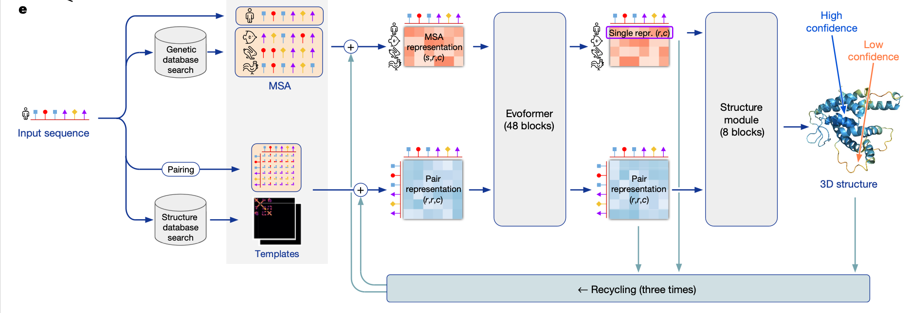
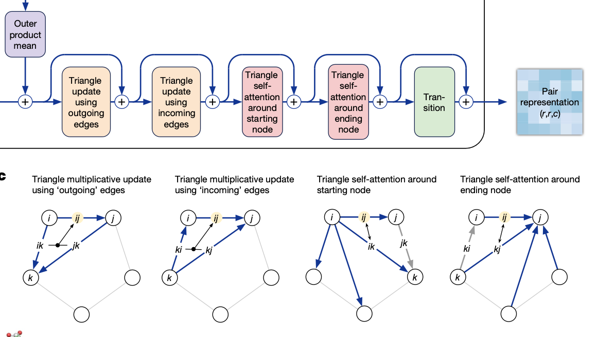

# AlphaFold 2

See https://www.nature.com/articles/s41586-021-03819-2

### Questions
- [Evoformer] What does "prediction of protein structures as a graph inference problem in 3D space in which the edges of the graph are defined by residues in proximity?": **A:** Edges - if two residues (e.g, aminoacids) are adjacent. The 3D constraint is explained below.
- [Structure Module]: The rotations and translations prioritize the orientation of the protein backbone so that the location of the side chain of each residue is highly constrained within that frame. **A:** This is done to reduce the search space. 
- [Training with labelled and unlabelled data]: The role of BERT. **A:** Learn residual correlation
**-** [MSA depth] The model uses MSAs and the accuracy decreases substantially when the median alignment depth is less than around 30 sequences. What is an MSA and how is it constructed? What is the meaning of median alignment depth? **A:** 
- [Methods: Training regimen] The final pair representation is linearly projected to a binned distance distribution (distogram) prediction, scored with cross entropy loss. Q: What is a distogram? **A:**

Use a deep learning architecture which combines Multi Sequence Alignment (MSA) and pairwise features (which can be used to model the physics). They also introduced new:

1. output representation and associated loss,
2. equivariant attention architecture,
3. use of intermediate losses to achieve iterative refinement of predictions,
4. masked MSA loss to jointly train with the structure, learning from unlabelled protein sequences using self-distillation and self-estimates of accuracy.

The AlphaFold network directly predicts the 3D coordinates of all heavy atoms for a given protein using the primary aminoacid sequence and aligned sequence of homologues as inputs.

The network comprises of two main stages:

1. Trunk processes the inputs through repeated layers of a NN block (the Evoformer) to produce a N_seq x N_res (number sequences and number of residues) that represents a processed MSA and a N_res x N_res array that represents residue pairs. The Evoformer block contains a number of attention-based and non-attention-based components. The key innovation in the Evoformer block is the new mechanism to exchange information within the MSA and pair representations that enable direct reasoning about the spatial and evolutionary relationships.
2. This is followed by a structure module. This introduces an explicit 3D structure in the form of a rotation and translation for each residue in the protein (**global rigid body frame**s: AlphaFold treats each single amino acid residue as an independent disconnected rigid body, with the spatial pose of each residue i defined by a local coordinate system centered on the Alpha Carbon. To place this resides in 3D space, each is assigned a transformation T_i relative to a global reference frame. This transformation then belongs to the Special Euclidean group SE(3), composed of a 3x3 rotation matrix and a 3D translation vector). The key innovations in this section of the network including: breaking the chain structure to allow simultaneous local refinement of all parts, an **equivariant transformer** to allow the network to reason about the unrepresented side-chain atoms, a **loss term** that places substantial weight on the orientational correctness of the residues.

## Evoformer

The key principle of the Evoformer is to view the prediction of protein structures as a graph inference problem in 3D space in which the edges of the graph are defined by residues in proximity.

The elements of the pair representation (which correponds to a N x N matrix of the positions of the individual amino acids, e.g, residues. Each cell contains a high-dimensional vector representing the network's current hypothesis about the spatial edge between i and j) encode information about the relation between the residues.

The columns of the MSA representation encode the individual residues of the input sequence while the rows represent the sequences in which those residues appear.

The MSA representation updates the pair representation through an element-wise outer product that is summed over the MSA sequence dimension. 

Within the pair representation, there are two different update patterns, both required by consistency:

1. Triangle inequality of distances - updates depend on triangles of edges involving 3 nodes. This is done in 2 ways: extra logit bias to axial attention and a non-attention update "triangle multiplicate update" that uses two edges to update the missing 3 edge.

Within the MSA representation, additional logits from the pair stack are projected to bias the MSA attention. This closes the loop, providing information flow from the pair representation back into the MSA representation. 

### End-to-End structure prediction 

### Structure Module

Follows the Evoformer and is composed by an Invariant Point Attention (geometry aware) module, which combines as inputs single and pair representations as well as backbone frames. This is then used to:

1. Predict relative rotations and translations, to generate the positions of the backbone frames
2. Predict the chi angles and compute all atom positions (with the input of 1)

The 3D backbone structure is represented as N_res i**ndependent rotations and translations**, each with respect to the global frame (residue gas; the name comes from the residues being independent and centered at 0). 

The rotations and translations prioritize the orientation of the protein backbone so that the location of the side chain of each residue is highly constrained within that frame.

Note: In an amino acid, the backbone consists of N, C_alpha and Carbonyl C. Since the bond lengths and angles between these 3 atoms are constant across all proteins, these are defined as an inflexible, rigid plate. Since every side chain attaches to the backbone at the C_alpha atom via a C_beta, then the 3D spatial coordinate of the attached base of the side chain is fixed.

OTOH, the peptide bond geometry is completely unconstrained; the network is observed to frequently violate the chain constraint during the application of the structure module. Breaking this constrains enables the local refinement of all parts of the chain without solving complex loop closure problems.

Satisfaction of the peptide bond geometry is encouraged during fine-tuning by a violation loss term.

Predictions of the side-chain chi angles, as well as the final per-residue accuracy of the structure (pLDDT) are computed with small per-residue networks on the final activations at the end of the network. The estimate of the TM-score (pTM) is obtained from a pairwise error predictions that is computed as a linear projection from the final pair representation.

### Training with labelled and unlabelled data

One can enhance accuracy with a procedure similar to Noisy Student Self-Distillation: https://arxiv.org/abs/1911.04252 :

1. Use trained network to predict the structure of 350k diverse sequences and make a new dataset of predicted structures filtered to a high-confidence subset.
2. Train the same architecture from scratch using a mixture of PDB data and the new dataset of predicted structures as training data, in which various data augmentations (as cropping and MSA subsampling) make it challenging for the network to recapitulate the previously predicted structures.

This self-distillation procedure makes effective use of the unlabelled sequence data improves the accuracy of the resulting network.

Individual residues within the MSA are also masked out - or mutated - to have a BERT-style objective predicting them. This objective encourages the network to learn phylogenetic and covariation relationships without hardcoding a particular correlation statistic into the features.

### Interpreting the neural network

Via training a separate structure module (the following block in the architecture) for each of the 48 Evoformer blocks. 

### MSA depth and cross-chain contacts

The model uses MSAs and the accuracy decreases substantially when the median alignment depth is less than around 30 sequences. We hypothesize that the MSA information is needed to coarsely find the correct structure within the early stages of the network, but refinement of that prediction into a high-accuracy model does not depend crucially on MSA information.

The other substantial limitation of AlphaFold is its weakness on proteins that have few intra-chain or homotypic contacts compared to heterotypic contacts. This typically occurs for bridging domains within larger complexes in which the shape of the protein is almost entirely created by interactions with the other chains in the complex.

MSA depth is computed by counting the number of non-gap residues for each position in the MSA, using the N_{eff} weighting schema and taking the median across residues.

The value of >30 is due to:

- Avoid spurious correlation when the median depth is lower than 30. There is simply too few matches.
- 

## Saved link previews

- [Highly accurate protein structure prediction with AlphaFold \| Nature](<https://www.nature.com/articles/s41586-021-03819-2>)
- [Self-training with Noisy Student improves ImageNet classification](<https://arxiv.org/abs/1911.04252>)
  We present Noisy Student Training, a semi-supervised learning approach that works well even when labeled data is abundant. Noisy Student Training achieves 88.4% top-1 accuracy on ImageNet, which is 2.0% better than the state-of-the-art model that requires 3.5B weakly labeled Instagram images. On robustness test sets, it improves ImageNet-A top-1 accuracy from 61.0% to 83.7%, reduces ImageNet-C mean corruption error from 45.7 to 28.3, and reduces ImageNet-P mean flip rate from 27.8 to 12.2.
    Noisy Student Training extends the idea of self-training and distillation with the use of equal-or-larger student models and noise added to the student during learning. On ImageNet, we first train an EfficientNet model on labeled images and use it as a teacher to generate pseudo labels for 300M unlabeled images. We then train a larger EfficientNet as a student model on the combination of labeled and pseudo labeled images. We iterate this process by putting back the student as the teacher. During the learning of the student, we inject noise such as dropout, stochastic depth, and data augmentation via RandAugment to the student so that the student generalizes better than the teacher. Models are available at https://github.com/tensorflow/tpu/tree/master/models/official/efficientnet. Code is available at https://github.com/google-research/noisystudent.

## Images

