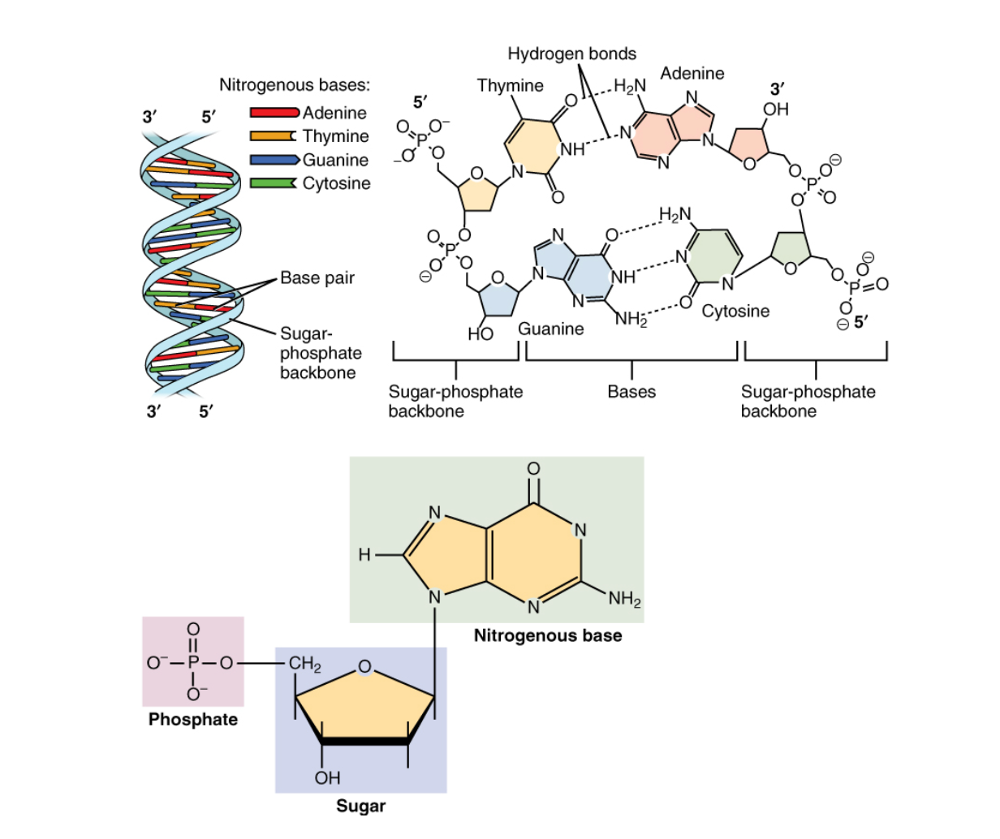

# AMIDD Book

## Preface
Mathematical, statistical and computational models have become essential to predict drug targets, identify drug molecules and to describe how a drug works.

- Mathematical models describe the state and the dynamics of a system,
- Statistical models represent assumptions about sample data, allowing us to use data analysis to infer the distribution of the variables of interest,
- Computational models implements the logic in procedures, which simulate the behavior of a system.

Models allow us to study the human body as a bio-chemical system, and to study body-drug interactions.

From a system's perspective, the goal of drug discovery is to identify a perturbation or combination of perturbations that switches the state of the sub-system from "disease" to "health", while causing as little harm as possible to whole system. A drug's capacity to do this is defined as its efficacy. Its capacity to cause adverse effects is called is toxicity. Models characterizing body-drug interactions reveal efficacy and safety profiles of drug candidates. 

Modern drug discovery can be thought of as an iterative process consisting of experiments and modelling.

Disease -> Data collection of disease and candidate molecules -> Models then characterize the disease and encode our understanding of body-drug interactions -> Use this knowledge to change the molecule to improve its efficacy and safety profile.

The book is structured in 3 parts:

1. Introduction to modern drug discovery,
2. Modelling at individual levels:
- Molecular,
- Celular,
- Organ and system,
- Population and reverse translation
3. Multiscale modelling: current practice and prospects

Pharmacokinetic (PK) modelling describes and predicts what the body does to the drug. Pharmacodynamic (PD) modelling describes and predicts what the drug does to the body.

## Chapter 2: A linear view of the drug discovery workflow

### Linear model structure

1. Disease understanding - the process of establishing cause-effect relationships in the context of human diseases that can be pharmaceutically exploited.
2. Target identification - the process of identifying one or few biological targets, such as proteins and RNAs, which shall be modulated by the drug candidate.
3. Lead identification and optimization - scaffolds of pharmaceutical potential are selected, and the structures are modified to improve the affinity, pharmacological and toxicological profiles of the drugs.
4. Preclinical development - a few drug candidates are tested in vivo or new approach methodologies (stem-cell derived organoids, organ-on-a-chip platforms) to select one candidate that will enter human testing in order to determine PK/PD and safety profiles of the candidate, as well as make other necessary preparations for the molecule in clinical testing.
5. Phase I - II clinical trials - the selected candidate is tested first in healthy volunteers, then in a small patient population and finally in a large cohort of patients.

### Disease understanding

 Breast cancer - In the 1980s, scientist found out that the HER2 protein (human epidermal growth factor receptor 2, also ERBB2) is highly abundant on the cell surface of tumor cells of some patients of breast cancer. This describes a correlation relationship but not a causal one.

Breast cancer cells were collected from patitents and cultured in artificial conditions (in vitro) to create a biological modelling system. Another example (in vivo xenograft model) is mouse specimens transplanted with breast-cancer tissues derived from a patient.

Besides in vitro and in vivo models, in silico models are used to model disease progression. These can causally describe entities and relationships between them using graphs and differential equation systems. They can model correlation and, under certain circumstances, infer causal relationships using statistical modelling techniques. Finally, they can implement computational procedures that model the behavior of biological systems underlying the disease.

### Target identification and validation

Decision: Pursue target-based or phenotypic discovery route?

In case we decide for a target-based approach, we ought to identify one or more biological entities, such as protein or mRNA, as our target. Once we have this target, we can discover chemical or biological entities that module its function.

There are many ways to identify targets:

- experiments in animal disease models,
- patient genetic data,
- modelling approaches that infer and simulate disease progress when the function of the targets is modulated.

 Common considerations on which target to work include:

- is there solid evidence that the disease progress can be influenced by modulating this target?
- is it feasible to develop specific therapeutics against this target with an acceptable safety profile?
- how likely is it to come up with a specific and potent enough molecule that modulates the target, given the constraints?

### Lead identification

Aims at identifying a molecule with promising physico-chemical properties and potentially acceptable efficacy and safety profile, which will be further optimized.

### Lead optimization

Aims to optimize the lead molecule to achieve better physico-chemical properties, hopefully translating into better efficacy and safety profiles. At the end of this process, a candidate compound is ideally selected to be further tested in preclinical and clinical studies.

### Preclinical development

Preclinical development aims at testing the candidate compound delivered by the lead optimization process to ensure its efficacy and safety profile. In addition, it includes formulation development, which involves mixing the drug (the drug is also known as active pharmaceutical ingredient, API) with a non-active material known as excipient. The therapeutic index (TI, also referred to as therapeutic ratio) quantifies the relative safety profile of a drug.

### Phase I clinical trial

Goal is to test the pharmacokinetic (what the body does to the drug) and safety profile of a drug. This is why it is tested on healthy subjects.

### Phase II clinical trial

Goal is to test both the pharmocokinetic and pharmacodynamic (what the drug does to the body) profiles of a drug, as well as safety and efficacy profiles in a small number of patients.

### Phase III clinical trial 

Extends Phase II by including many more patients. In order to get regulatory approval, the sponsor of a tested drug - can be phama companies, research institutes, ... - usually must submit successful results of two Phase III clinical trials, with Type-I errors less than 0.05 in each trial (e.g, that the probability that the drug does not wotk is smaller than 1 out of 20).

### Reflections on the linear model of drug discovery

Despite the usefulness of the linear model, drug discovery is in reality rarely linear. Instead, it is a dynamic and iterative process, with countless variants from the ideal linear model. For example, during the discovery process, a lead compound may fail to show the expected efficacy in the preclinical experiment and therefore a new round of lead optimization is necessary or even a new hit series has to be identified.

In another example, a drug that has been designed for one indication is found, either by real-world evidence or serendipity, to be potentially effective for another indication, and thus the step of target identification, hit and lead optimization may be omitted or strongly shortened to meet the purpose.

In the development phase, more and more clinical trials are designed differently compared to the canonical ones, for instance with adaptive design and with real-world data supported virtual trials.

## Chapter 3: A multiscale-modelling view of the drug discovery 

See references on Multiscale modelling in https://www.researchgate.net/publication/44646748_Multiscale_Modeling_in_Drug_Discovery_and_Development_Future_Opportunities_and_Present_Challenges
https://onlinelibrary.wiley.com/doi/book/10.1002/9781119987260
https://shop.elsevier.com/books/theoretical-foundations-of-multiscale-modelling/cascella/978-0-323-88440-2

## Chapter 4: Central Dogma and Drug Targets

### 4.1: The Central Dogma

Information stored in DNA is transcribed into ribonucleic acids (RNA) by a large apparatus of transcription. Some RNA species are translated into chains of aminoacids, which then form proteins.

Proteins are the main building blocks of body, they catalyse chemical reactions which generate metabolites and act as signal sensors and function executors between cells and their environments.

The central goal of drug discovery, viewed from the angle of biological networks, is to identify nodes and edges that can be modulated to halt or reverse a disease condition, and to discover chemical molecules or biological entities to achieve that goal with acceptable safety profiles.

### 4.2: Drug targets

Drugs are molecules that operate on the biological network with the purpose of halting or reversing drug disease progression. The most common form of operation is modulating the function of individual proteins, which we call drug targets.

It is possible, however, for drugs to target other nodes than proteins, namely DNA, RNA, metabolites or larger structures such as cell organelles or cells.

It is also possible for drugs to target the edges of the network. Some antiviral and antibacterial drugs inihibit the process of transcription, thereby hindering the synthesis of viral or bacterial RNA from respective DNA templates. Others modulate the process of translation. Yet other inhibit the binding of transcription to DNA, thereby regulating gene expression and cell fate.

## Chapter 5: Biological sequence analysis

### 5.2: Typical questions in drug discovery that call for biological sequence analysis

- Are there other genes similar to the target X that may increase the effect of the drug and/or cause side effects when the drug interferes with their functionalities?
- Is it appropriate to test drug candidates of target X in mouse, rat or other model species?
- How variable are the coding sequences of target X among the general population and among patients of a certain disease?
- Can we design efficacious and safe RNA-based therapies that target the transcript of X potently and specifically to revert the disease?
- Can we design efficacious and safe gene therapy that specifically increases or decreases expression of target X?

### 5.3: Central dogma of molecular biology

DNA is the core repository of information in biological systems. Through:

- **replication** it generates more of itself, 
- **transcription** it generates RNA,
- **reverse transcription** it is generated from RNA

RNA can also replicate itself. Its **translation** leads to proteins.

### 5.5: RNA

Almost the same as DNA but has ribose as the pentose sugar instead of the dexoyribose. Exists mostly as a single strand. In most organisms, uracil is used in RNA instead of thymine.

### 5.7: Drugs target either the nodes or the edges of the graph

- Proteins are the targets of most drugs, accounting for more 80% of all targets. Among these, the most targeted ones are enzymes (31%), followed by ion channels (21%), GPCR (16%), kinase (8%), transporters (4%), nuclear receptors (3%) and epigenetic factors (2%).
- RNA can be targeted by antisense-oligonucleotides (ASO). These are modified short DNA or RNA molecules that bind to an RNA target, leading to a reduced expression of the protein target. The binding happens through the Watson-Crick Base Pairing, which happens in 2 steps: 1. hydrogen bonding, which has two pairing states - G with C, via 3 hydrogen bonds, and A and T/U, via 2 hydrogen bonds, 2. steric boundary condition, which has 2 structural categories - Purines (A, G), composed of two fused rings, Pyrimidines (C, T, U), composed of one ring. The mechanism dictates a **Purine**-**Pyrimidine** pairing.

Exercise

1. Derive the reverse-complement sequence of fomivirsen
Fomivirsen has the following sequence: 5'-GCG TTT GCT CTT CTT CTT GCG-3'
Since the complement of G is C and the complement of A is T, the sequence is given by

GCG TTT GCT CTT CTT CTT GCG
CGC AAA CGA GAA GAA GAA CGC

The complementary of 5' (3') is 3' (5'), so

3'-CGC AAA CGA GAA GAA GAA CGC-5'

2. Use the BLAST algorithm and find the RNA/protein targeted by fomivirsen
https://blast.ncbi.nlm.nih.gov/Blast.cgi

How to query BLAST:

**Endpoint:** Nucleotide BLAST (blastn).
**Query:** GCGTTTGCTCTTCTTCTTGCG
**Database:** Nucleotide collection (nr/nt).
**Algorithmic Constraint (Crucial Step):** Because the query is extremely short (21 base pairs), standard megablast parameters will fail or return noise. You must select **"Somewhat similar sequences (blastn)"** and adjust the algorithm parameters for short sequences (automatically lowering the word-size threshold to 7 or 11 and increasing the Expect threshold / E-value).

### 5.8: The human genome

Protein-coding sequences account for only a very small fraction of the genome, around 1.5%. The rest is associated with non-coding RNA genes, regulatory DNA sequences and other elements.
Protein-coding genes are transcribed into mRNA. 

- Transcriptional regulation: interaction between DNA sequences in the gene regulatory region and proteins dedicated to regulate gene expression.
- The gene regulatory regions contains DNA sequences that have certain functions, known as the regulatory elements.
-- The core promoter: controls basal expression. This is the minimum sequence required to assemble the basal transcription machinery. **Dictates where transcription starts.**
-- Proximal promoter elements: contain short 6-12 bases DNA sequences upstream of the core region. **Dictates how efficiently and how often it starts.**
-- Enhancers and silencers
-- Insulators

### 5.10: Levenshtein distance

Between two words is the minimum number of single character edits, which include insertions, deletions and substitutions required to change one word into another.

The space and time complexity of the dynamic programming algorithm (Wagner-Fisher) of calculating the Levenshtein distance is about O(mn).

### 5.11: Substitution matrix

The default edit distances assumes that the cost of insertion, deletion and substitution is identical. This assumption, however, fails to capture some properties of biological sequences:

- In protein coding sequences, substitutions are more likely to happen rather than insertion or deletion. This is because substitutions preseve the reading frame.

To improve the characterization, one can replace the costs with biology-driven ones.

### 5.12: Needman-Wunsch algorithm

Check https://www.ebi.ac.uk/jdispatcher/psa/emboss_needle/summary?jobId=emboss_needle-I20260627-094858-0818-11745902-p1m

Useful information
An introduction to Applied Bioinformatics: https://readiab.org/

## Chapter 6: Proteins as drug targets and drugs

### 6.2: Hidden Markov Model

Most protein sequences are composed from a relatively small number of ancestral protein domain families. Because the number of known protein sequences continues to increase, it is more efficient to compare sequences against all known domain families rather than known sequences.

**The idea**: identify subunits of protein sequences and annotate them. This is done by aligning sequences and determining their similarities via a probabilistic model. These are called profile HMMs (or just profiles) and can be used for :

1. Sensitive homology searches: build a profile based on multiple sequence alignment and search the profile against a sequence database,
2. Automated annotation of protein domains,  

Profile HMMs are primary sequence consensus models. They assume that the residue at a particular position is independent of the residues at all other positions, thereby ignoring high-order correlations. **This makes them ill suited for modelling structural RNAs, since the base pairs are correlated.**

They also lack an explicit model of phylogenetic relationshpis between a set of homologous sequences.

### 6.5 Protein Structure Determination

There are three ways to determine protein structure

1. X-ray crystallography: uses the diffraction of high-energy X-rays by the electron cloud. Because a single protein yields insufficient signal, it must be ordered into a 3D crystal. The crystal lattice then generates constructive interference, amplifying the signal.
2. NMR: uses the QM spin properties of the atomic nuclei in a strong magnetic field. Radiofrequency pulses excite these nuclei and, by measuring the resonant frequencies and the magnetization transfer between adjacent nuclei (Nuclear Overhauser Effect), one can compute the exact distances between specific atoms. It is restricted to small proteins (<30-40 kDa).
3. CryoEM: uses electron scattering. The protein sample is frozen in liquid ethane and a high-energy electron beam is fired through the sample. Because the electrons interact with the electrostatic field of both the nuclei and the electrons of the protein, it casts 2D projection images onto a direct electron detector. It does not work for very small proteins (< 50 kDa) due to the lack of constrats with the ethane medium. 

**Nuclear Overhauser Effect**: transfer of nuclear spin polarization from one spin population to another via cross-relaxation. Works through magnetic dipole-dipole interactions. 

Consider a system of two spin 1/2 nuclei I and S, placed in a static external magnetic field; this splits the degenerate energy levels in 4 eigenstates. The NOE experiment begins by introducing a RF perturbation at the Larmor frequency of spin S. This drives transitions between the energy levels of S, leading to saturation. The system is out of thermodynamic equilibrium, but the populations of I remain momentarily unchanged.

To re-establish thermal equilibrium, the system undergoes spin-lattice relations; because I and S are close to each other, their magnetic dipoles couple. The relaxation is governed by 3 transition probabilities:

1. W_1: Single quantum; the relaxation of a single spin;
2. W_0: Zero quantum; a mutual flip and flop where I and S undergo simultaneous opposing transitions;
3. W_2: A simultaneous flip where both spins transition in the same direction.

The change in spin I intensity is dictated by the cross-relation rate, W_2 - W_0 (if > 0, positive NOE, if < 0, negative NOE) The balance between these two quantities depends entirely on the frequencies generated by the molecule's random rotational tumbling. The latter can either be defined as fast (small molecules, positive NOE) or slow (large molecules, negative NOE).

### 6.6 Homology modelling (HM)

Generating 3D molecular structures for a target protein from its 1D amino acid sequence. Relies on the biological axiom that protein 3D structures are evolutionary more conserved than their primary sequences. If two proteins share significant sequence identity, they will fold into nearly identical 3D topologies.

**Definitions**

Identity: the proportion of pairs of identical residuals between two aligned sequences. Depends on how the sequences are aligned
Similarity: the proportion of pairs of similar residues between two aligned sequences. The similarity is determined by the substitution matrix. Depends on how the sequences are aligned and on the substitution matrix used.
Homology: two sequences are homologous IIF they have a common ancestor. They are either homologous or not.

**Principles**

Go from the protein sequence (e.g, query) -> 3D structure.

- for at least 30% identity between the query and the template, we can do homology modelling,
- for identity between 30% and 60%, one can model site-directed mutagenesis,
- for identity larger than 60%, one can achieve substrate specificity and a comparable resolution to NMR,

- HM helps getting a rough idea of where the alpha carbons of key residues sit in the folded protein. It can guide mutagenesis experiments and define hypothesis about structure-function relationships,
- HM is not reliable for predicting the conformations of insertions or deletions, as well as the details of the side-chain positions,

### 6.6 Homology Modelling

- Homology models are unlikely to be useful when modeling ligand docking (e.g, drug design) unless the sequence identity with the template is larger than 70%. Even if the case, the results are less reliable than crystallography, NMR or cryo-EM.

An alpha carbon is the central carbon atom of an amino acid. This acts as the structural center of the amino acid and forms 4 covalent sigma bonds to 4 distinct components:

- An amino group (- NH_2)
- A carboxyl group (- COOH)
- A single hydrogen atom (- H)
- A variable side chain

Because it binds to four different groups, it is a chiral center. It exists in two geometries, the L-isomer and the D-isomer; however, mammalian biological systems exclusively utilize L-amino acids. As a result, a synthetic peptide drug engineered with a D-amino acid at the alpha carbon position will resist degradation.

### The 8 setps of homology modelling

### 1. Template identification and initial alignment

Template identification with BLAST: compare the query sequence against sequences with structures in PDB.

### 2. Alignment correction

A good alignment should not contain too many gaps, should have a few patches of high similarity, rather than spread isolated residuals.

### 3. Backbone generation

Copy the coordinates of the template residues identical between the query and the template.

### 4. Loop modelling

Most alignments contain gaps; 

- gaps in the model sequence are addressed by omitting residues from the template,
- gaps in the template sequence are treated by inserting missing residues into the continuous backbone

### 5. Side-chain modelling

Libraries of common rotamers (rotation isomers) extracted from high-resolution X-ray are used to position side chains. Various rotamers are explored and scored with a variety of energy functions.

### 6. Model optimization

To predict the side chain with high accuracy, one needs to correct the backbone, which depends on rotamers and their packing. One can adjust this by iteratively model the rotamers and backbone structure, using for example, the EM algorithm.

### 7. Model validation

### 8. Iterate to correct mistakes

Small errors induced during the optimization step may be removed by running a molecular dynamics simulation. An error in the loop may be corrected by choosing another loop conformation.

See EMBO course in http://aidanbudd.github.io/ppisnd/programme.html

## Saved link previews

- [BLAST: Basic Local Alignment Search Tool](<https://blast.ncbi.nlm.nih.gov/Blast.cgi>)
  The Basic Local Alignment Search Tool (BLAST) finds regions of local similarity between sequences. The program compares nucleotide or protein sequences to sequence databases and calculates the statistical significance of matches. BLAST can be used to infer functional and evolutionary relationships between sequences as well as help identify members of gene families.
- [Multiscale Modeling in Drug Discovery and Development: Future Opportunities and Present Challenges](<https://www.researchgate.net/publication/44646748_Multiscale_Modeling_in_Drug_Discovery_and_Development_Future_Opportunities_and_Present_Challenges>)
  Download Citation | Multiscale Modeling in Drug Discovery and Development: Future Opportunities and Present Challenges | Modeling and simulation (M&S) is a diverse discipline that uses tools from mathematics, statistics, and computer science to arrive at quantitative... | Find, read and cite all the research you need on ResearchGate
- [Job Dispatcher homepage \| EMBL-EBI](<https://www.ebi.ac.uk/jdispatcher/psa/emboss_needle/summary?jobId=emboss_needle-I20260627-094858-0818-11745902-p1m>)
  The Job Dispatcher at EMBL-EBI offers free access to a range of bioinformatics tools and biological datasets through its web and programmatic interfaces. It also powers various popular sequence analysis services hosted at the EMBL-EBI, including InterProScan, UniProt, and Ensembl Genomes.
- [Theoretical Foundations of Multiscale Modelling - 1st Edition \| Elsevier Shop](<https://shop.elsevier.com/books/theoretical-foundations-of-multiscale-modelling/cascella/978-0-323-88440-2>)
- [Exploring Computational Pharmaceutics ‐ AI and Modeling in Pharma 4.0](<https://onlinelibrary.wiley.com/doi/book/10.1002/9781119987260>)
  Provides an extensive and up-to-date overview of the theory and application of computational pharmaceutics in the drug development process Exploring Computational Pharmaceutics - AI and Modeling in Pharma 4.0 introduces a variety of current and emerging computational techniques for pharmaceutical research. Bringing together experts from academia, industry, and regulatory agencies, this edited volume also explores the current state, key challenges, and future outlook of computational pharmaceutics while encouraging development across all sectors of the field. Throughout the text, the authors discuss a wide range of essential topics, from molecular modeling and process simulation to intelligent manufacturing and quantitative pharmacology. Building upon Exploring Computational Pharmaceutics - AI and Modeling in Pharma 4.0, this new edition provides a multi-scale perspective that reveals the physical, chemical, mathematical, and data-driven details of pre-formulation, formulation, process, and clinical studies, in addition to in vivo prediction in the human body and precision medicine in clinical settings. Detailed chapters address both conventional dosage forms and the application of computational technologies in advanced pharmaceutical research, such as dendrimer-based delivery systems, liposome and lipid membrane research, and inorganic nanoparticles. A major contribution to the development and promotion of computational pharmaceutics, this important resource: Discusses the development track, achievements, and prospects of computational pharmaceutics Presents multidisciplinary research to help physicists, chemists, mathematicians, and computer scientists locate problems in the field of drug delivery Covers a wide range of technologies, including complex formulations for water-insoluble drugs, protein/peptide formulations, nanomedicine, and gene delivery systems Focuses on the application of cutting-edge computational technologies and intelligent manufacturing of emerging pharmaceutical technologies Includes a systematic overview of computational pharmaceutics and Pharma 4.0 to assist non-specialist readers Covering introductory, advanced, and specialist topics, Exploring Computational Pharmaceutics - AI and Modeling in Pharma 4.0 is an invaluable resource for computational chemists, computational analysts, pharmaceutical chemists, process engineers, process managers, and pharmacologists, as well as computer scientists, medicinal chemists, clinical pharmacists, material scientists, and nanotechnology specialists working in the field.

## Images

