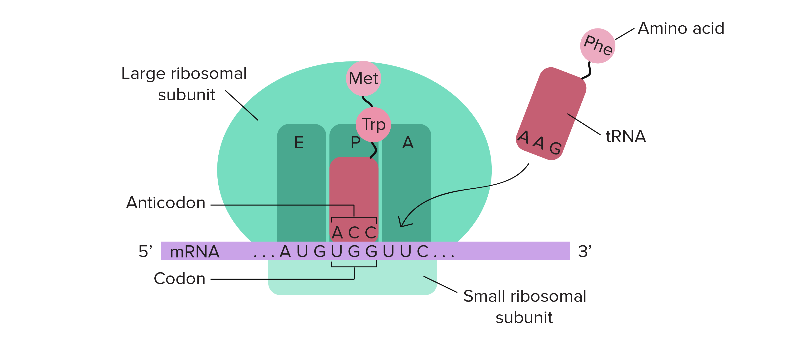

# AIMDD Lecture 4: Biological foundation of drug discovery

The central dogma applies to human and viruses, including SARS-CoV-2. 

## RNA is transcribed from DNA

DNA can be transcribed to mRNA (since each of the nucleotides has a unique identification). Blocks of these, **called codons, can be mapped into a protein via translation, which is composed of peptides**. See figure of page 9 to see how the mRNA, the ribosome and the tRNA join forces to generate a (growing) polypeptide chain.

DNA is composed of **two strands of sugar-phosphate backbone** on each side, and the core is composed by **pairs of the four nitrogenous basis**: adenine, thymine, guanine and cytosine. The pairs are linked by hydrogen bonds.

The nucleotides are formed by these nitrogenous basis, together with a pentose sugar and a phophate. They serve as monomeric units of the nucleic acid polymers.

### Codons

Sequences of three adjacent nucleotides (either A, U, C, G) in a mRNA molecule. There are 64 possible codons (4^3):

- 61 codons map directly to 20 proteinogenic amino acids,
- 3 codons (UAA, UAG, UGA) map to terminate the sequence,
- 1 codon (AUG) acts both as the amino acids Methionine and the start signal for the sequence.

Multiple codons can map to the same amino acid but a single codon can not code more than one amino acid.

## mRNA is translated into proteins

Information encoded in the mRNA directs the addition of aminoacids during protein synthesis. This process, known as translation, takes place on ribosomes in the cell cytoplasm. The ribosomes connect the mRNA with the tRNA and the latter is responsible for creating the polypeptide chain.

The tRNA has a complementary code on one end and a peptide on the other end. They connect with the mRNA on the A block, while the polypeptide chain gets formed on the P block. Once the tRNA has passed its polypeptide, it exists on the E block.

Different cells have different DNA "active" segments and therefore different RNAs/proteins are expressed.

## Our body contains a variety of cells

1. Erythrocytes (Red Blood Cells): ~84.0%
2. Platelets: ~4.9%
3. Bone Marrow Cells: ~2.5%
4. Vascular Endothelial Cells: ~2.1%
5. Lymphocytes (White Blood Cells): ~1.5%
6. Glial Cells & Neurons: ~0.8% combined
7. Epidermal Cells: ~0.2%
8. Adipocytes (Fat Cells): ~0.17%
9. Skeletal Myocytes (Muscle Cells): < 0.002%

## A hierarchical system of cells, tissue, organ, organ system and human body

**Cells**: **basic building blocks**. These have variable morphologies and functions (example, Epithelial)
**Tissues**: these are **groups of specialized cells** that communicate and collaborate (example Epidermis)
**Organ**:  these are **groups of tissues** that **perform specific functions** (example, Skin)
**Organ systems**: **group of organs and tissues** (example, Integumentary system)

### Unmodified RNA induces unwanted immune reactions: modifying RNA can reduce or remove them

RNAs are synthesized from four ribonucleotides: **ATP** (adenosine), **CTP** (cytidine), **UTP** (uridine) and **GTP** (guanosine) (Triphosphate). When **unmodified RNAs** are delivered into cells, they **induce unwanted immune reaction** because they **activate surface proteins** known as Toll-like receptors (**TLRs**). These lead to the **release of cytokines** including TNF-alpha. TLRs and TNF-alpha are also activated by bacterial and viral infections and mediate their killing.

**tRNA**, however, **does not induce immunogenicity** because it contains **pseudouridine** (psi). This prompted researchers to modify the mRNA to mimick tRNA.

See image in slide 24: the incoming tRNA is bound to an aminoacid, which then is concatenated to the growing chain once it comes the tRNA turn to dock on the messenger RNA.

## Further modification of pseudouridine (to N1-methyl-psi) and LNP delivery are critical for the success of mRNA vaccines

N1-methyl-psi modified mRNA:
- diminishes the activity of innate immune sensors,
-- Toll-Like Receptors (TLR7 and TLR8) located in endosomes, and RIG-I and MDA5 located in the cytosol are calibrated to detect single-stranded RNA containing unmodified uridine, which is a signal of viral infection. Uridine binds to these receptors, it does so through highly specific hydrogen-bonding networks and spatial docking. **Pseudouridine changes the standard N-glycosidic bond** (connecting the base to the sugar ring) t**o a C-glycosidic bond**, and the added methyl group at the N1 position alters the molecule's electrostatic surface and steric bulk. **This topological change prevents the mRNA from structurally fitting into the binding pockets of TLR7/8 and RIG-I.**
- improves the translational capacity,
-- Normally, when cellular immune sensors detect exogenous RNA, they activate Protein Kinase R (PKR). PKR phosphorylates a critical translation initiation factor called eIF2-α. This would cause the cell to stop translation (in order to prevent viral replication). Because of the latter point**, the PKR is not activated and the cell's ribosomes can continuously translate the mRNA into the spike protein.**
-- The altered thermodynamic stability and base-pairing dynamics of N1-m-psi optimize the decoding rate. It reduces ribosome stalling and frameshifting, yielding a higher net output of properly folded target protein per mRNA transcript.
- increases the protection of the RNA against nucleases
-- Exogenous mRNA is normally degraded in minutes by ribonucleases (RNases), which are enzymes that cleave the phosphodiester bonds of the RNA backbone. 

**RNases require a specific RNA backbone geometry to cleaves its strand.** The C-C glycosidic bond in pseudouridine introduces rotational rigidity to the RNA backbone compared to the flexible N-C bond of standard uridine. Furthermore, the methyl group creates local steric hindrance. 

This physical obstruction and increased backbone rigidity make it thermodynamically unfavorable for the RNase active site to align with the phosphodiester bonds. The molecule becomes highly resistant to enzymatic hydrolysis, extending its half-life in the cytoplasm long enough to generate a sufficient dose of the spike protein.

### Medical need - We need a large amount of vaccines

C1 - no coronavirus vaccine is available,
C2 - classical vaccines are not feasible due to capability and time
C3 - genetic sequence of the coronavirus may change over time

### Target and modality - Spike protein / mRNA vaccine

C4 - mRNAs alone are too large and charged to pass lipid bilayers,
C5 - mRNAs are readily degraded by ribonucleases,
C6 - Exogenous mRNA triggers immunogenicity.

### (Modifications to improve) PK/PD profiles: (1) LNPs delivering and protecting mRNA, (2) N1-methyl-psi modification, (3) hemoglobin 5'-UTR

### Benefit/risk assessment

### Patient stratification

## Coding sequence of the spike protein alone is not enough: mRNA transcription depends on the 5'-UTR and 3'-UTR too

The process of gene expression in eukaryotes:

1. RNA polymerase, an enzyme, binds to the promoter region of the gene. It reads the DNA from the 5' untranslated region (UTR) to the 3' UTR to synthesize pre-mRNA via transcription.
2. Pre-mRNA receives a modified nucleotide (7-methylguanosine triphosphate) at the 5' end as a cap, and a repeated adenine sequence (poly-A tail) at the 3' end. 
3. Pre-mRNA is spliced to remove introns. Note that the 5' untranslated region now sits between the cap and the initiation codon, and the 3' untranslated region sits between the termination codon and the poly-A tail. In bewtween sits the coding sequence, together forming mature mRNA.
4. Mature mRNA is transported from the nucleus to the cytoplams for translation (into a protein).

## 5'-UTR of human hemoglobin is a good choice to make sure that the vaccine sequence is stable and highly translated

- Hemoglobin is a protein that transports oxigen,
- It consists of 3 subunits: alpha, beta and delta. These are encoded by three highly similar genes known as HBA, HBB and HBD,
- It is present in erythrocytes (red blood cells) of almost all vertebrates,
- **The protein is essential, therefore its associated mRNA is relatively stable and highly translated.**

## LNP, modified RNA, and 5'-UTR of HBA are all essential to make effective and safe vaccines against coronavirus

Check the diagram of Slide 29. The spike mRNA contains the following modifications:
- At the start of the sequence, a cap, together with the 5'-UTR,
- In the S gene, the m1psi,
- At the end, the 3'-UTR together with the poly-A

Note that there is a nearly identical sequence between the 5'-UTR of Human HBA1 and the BNT162b2 (the mRNA of Pfizer Covid-19 vaccine).

## A summary of what we learned so far in the context of the coronavirus

1. **What is the unmet medical need?** A vaccine to prevent a large population of individuals from being infected by the coronavirus.
2. **What are the targets of our drug?** Spike protein is conserved: immune reaction is desired. (Since the Covid spike protein is pretty constant across several types, we shall use this as the target. It is the mRNA of the spike protein that we want to deliver to our cells via the vaccine for translation and generation of antigenes. See slide 21)
3. **Where should the drug go** in the patient's body, what does the body do to the drug (**PK**), what does the drug do to the body (**PD**)? Thanks to LNP, m1psi and the 5'-UTR of HBA, the mRNA vaccination can enter cells with minimal side effects. Inside the cell, the **spike protein RNA is synthesized into proteins**, which are **digested, presented and elicit immune response**.
4. What is the safety profile of the drug in light of its benefits?
5. Who are responsive to the drug, or susceptible to adverse events?
 
### Most drugs work by binding to and modulating protein targets

### Summary

1. The central dogma dictates information flow in biological systems. Its components - DNA, RNA, proteins, metabolites - and processes - transcription, translation, and enzymic reactions - serve as drug targets.
2. Human bodies consist of cells that show different patterns of "active" DNAs, expressed RNAs and proteins. The efficacy and safety of drugs need to be considered in the context of different cells. This is one of the reasons why animal studies are indispensable.

### Offline activities

### Read through https://www.nobelprize.org/prizes/medicine/2025/popular-information/ and write questions

Mary E. Brunkow, Fred Ramsdell and Shimon Sakaguchi are awarded the Nobel Prize in Physiology or Medicine 2025 for their groundbreaking discoveries concerning *peripheral immune tolerance* that prevents the immune system from harming the body.

One of the immune system's marvels is the ability to identify pathogens and differentiate them from the body's own cells. How does the immune system keep track of what to attack and what to protect? Why doesn't the immune system attack our bodies more frequently?

The Nobel Prize laureates identified the regulatory T cells.

T cells are the key players in our body's defense:
- Helper T cells patrol the body and, if they discover a threat, alert other immune cells.
- Killer T cells eradicate cells which have been infected by a virus or other pathogens. They can also attack tumour cells.

All T cells have special proteins - T-cell receptors - on their surface that can scan the surface of other cells for fragments and check whether a cell has been infected. These cells are built from genes which are **randomly** combined.

The vast number of T cells with different receptors ensures that there are always some that can detect the shape of an invading microbe (Figure 2), including new viruses. However, the body inveitably also creates T-cell receptors that can attach to parts of the body's own tissues. 

So, the key question: What makes T cells react to hostile microbes but not our own cells?

When T cells mature in the thymus, special cells hold out fragements of the body's own proteins to the T cells. If there is a match, these T cells are removed, in a process called **central tolerance**.

Sakaguichi found that different forms of T cells carry CD4 (not just the helper T cells) and that the novel T cells carried both CD4 and CD25 on their surface. Injecting mice with no thymus - which lead them to develop autoimmune diseases due to an overactive immune system - with CD25 cells caused the mice to be healthy. 

Note: killer T cells are distinguished by CD8. 

In 2001, in *Nature Genetics*, Mary Brunkow and Fred Ramsdell revealed that mutations in the *FOXP3* gene cause both the human disease called IPEX and the scurfy mice’s ill health. Two years later, Shimon Sakaguchi could convincingly prove that the FOXP3 gene controls the development of regulatory T cells.

These cells prevent other T cells from mistakenly attacking the body's own tissue, which is important for a process called peripheral immune tolerance. Regulatory T cells also ensure that the immune system winds down after it has eliminated an invader.

Mapping of tumours shows that they can attract large numbers of regulatory T cells that protect them from the immune system. Researchers are therefore trying to find ways to dismantle this wall of regulatory T cells, so the immune system can access the tumours.

In autoimmune diseases, researchers are instead trying to promote the formation of more regulatory T cells. In pilot studies, they are giving patients *interleukin-2*, a substance that makes regulatory T cells thrive. Researchers are also investigating whether interleukin-2 can be used to prevent organs being rejected after transplantation.

### Backup slides

Follow-ups: https://pharmrev.aspetjournals.org/article/S0031-6997(24)01085-8/abstract

### Read through https://accio.github.io/AMIDD/assets/2025/04/Hughes-2011-Principles.pdf

The initial research, often ocurring in academia, generates data to develop a hypothesis that the inhibition or activation of a protein or pathway will result in a therapeutic effect in a disease state. The outcome of basic research is the selection of a target, which may require further validation prior to progression into the lead discovery phase.

**Target Identification**

One of the most important steps in developing a new drug is **target identification** and **validation**. A target is a broad term which can be applied to a range of biological entities, including proteins, genes and RNA.

A good target needs to be:
- efficacious,
- safe,
- meet clinical and commercial needs,
- "druggable", e.g, accessible to the putative drug molecule, thereby eliciting a biological response that may be measured both in vitro and in vivo,

Certain target classes are more amenable to **small molecule** drug discovery - **G-protein coupled receptors** (these are cell surface receptors which detect molecules outside of the cell and activate cellular responses),
**Antibodies**, on the other hand, are good at blocking **protein/protein interactions**.

The data which are available to identify targets comes from:
- publications and patent information,
- gene expression data,
- proteomics data,
- transgenic phenotyping,
- compound profiling data

Identification approaches also include examining **mRNA/protein levels to determine whether they are expressed in disease and if they are correlated with disease exacerbation or progression**. Another powerful approach is to look for **genetic** **associations**. For example, familial Alzheimer's Disease (AD) patients commonly have mutations in the amyloid precursor protein or presenilin genes which lead to the production and deposition in the brain of increased amounts of the Abeta peptide, characteristic of AD.

An alternative approach (to genetic associations) is to use **phenotypic screening** to identify disease relevant targets. Rather than focusing on the specific protein or gene causing the disease, phenotypic screening **takes a complex biological system that exhibits a specific disease "phenotype"** (e.g, observable trait, as rapid division or protein aggregation, in the case of AD). One then applies **thousands of chemical compounds to these cells to see which one reverts the disease phenotype back to an healthy state.**

The phenotype in the case of Kurosawa is the binding profile, the chemical compounds being the antibodies, the readout being immunostaining. Antibodies that successfully stained malignant cells but not healthy cells were selected as hits. 

**Target Validation**

Techniques:
- in vitro,
- animal models,
- modulation of a desired target in disease patients,

See more examples in Figure 3.

Antisense technology is a potentially powerful technique which utilizes RNA-like chemically modified oligonucleotides which are designed to be complimentary to a region of a target mRNA molecule. Binding of the antisense oligonucleotide to the target mRNA prevents binding of the translational machinery, thereby blocking synthesis of the encoded protein.

(TL;DR: something else couples to the target mRNA so that the translational machinery can no longer couple and thereby synthesize the protein)

In contrast to the gene knockout approach, antisense oligonucleotide effects are reversible and a continued presence of the antisense is required for target protein inhibition. However, **creating oligonucleotides is difficult and result in molecules with limited bioavailability and pronounced toxicity, making their in vivo use problematic**. This has been compounded by non-specific actions, problems with controls for these tools and a lack of diversity and variety in selecting appropriate nucleotide probes.

In constrast, transgenic animals are an attractive validation tool as they involve whole animals and allow observation of phenotypic endpoints to elucidade the functional consequence of gene manipulation. In the early days of this field, animals were generated that lacked a given gene's function from inception. This yielded great insights into the in vivo functions of a wide range of genes.

One example is the use of the P2X7 knockout mouse to confirm a role for this ion channel in the development and maintenance of neuropathic and inflammatory pain. In mice which lacked the P2X7 receptors, inflammatory and neuropathic hypersensitivity is completely absent to both mechanical and thermal stimuli, while normal nociceptive processing is preserved.

An alternative of gene knockouts are gene knock-ins, where a non-enzymatically functioning protein replaces the endogenous protein. These animals can have a different phenotype to a knockout, for example when the protein has structural as well as enzymatic functions and these mice should ostensibly mimic more closely what happens during treatment with drugs; the protein is there but functionally inhibited.

Because the use of transgenic animals is expensive and time-consuming, usage of small interfering RNA (siRNA) has become increasingly popular for target validation:

Double-stranded RNA (dsRNA) specific to the gene to be silenced is introduced into a cell or organism, where it is recognized as exogenous genetic material and activates the RNAi pathway. The ribonuclease protein dicer is activated which binds and cleaves dsRNAs to produce double-stranded fragments of 21-25 base pairs with a few unpaird overhang bases on each end. These short double-stranded fragments are called siRNAs. 

These siRNAs are then separated into single strands and integrated into an active RNA-induced silencing complex (RISC). After integration into the RISC, siRNAs base-pair to their target mRNA and induce cleavage of the mRNA, thereby preventing it from being used as a translation template.

However, RNAi technology still has the major problem of delivery to the target cell, but many viral and non-viral delivery system are currently under investigation.

Monoclonal antibodies are an excellent target validation tool as they interact with a larger region of the target molecule surface, allowing for better discrimination between even closely related targets and often providing higher affinity. In contrast, small molecules are disadvantaged by the need to interact with the often more conserved active site of a target, while antibodies can be selected to bind to unique epitopes**. This specificity is the basis for their lack of non-mechanistic (or "off-target") toxicity - a major advantage over small-molecule drugs.**

OTOH, **antibodies cannot cross cell membranes, restricting the target class mainly to cell surface and secreted proteins.** 

The classic target validation tool is the small bioactive molecule that interacts with and functionally modules effector proteins.

More recently, chemical genomics, a systemic application of tool molecules to target identification and validation has emerged. This is the study of genomic responses to chemical compounds, with the goal of rapidly identifying novel drugs and targets by using multiple early phase technologies. Chemical genomics brings together diversity-oriented chemical libraries and high-information-content cellular assays, along with the informatics and data mining tools for storing and analysing the generated data. The ultimate goal of this approach is to provide chemical tools against every protein encoded by the genome.

**The hit discovery process**

Together with the lead discovery phase where compound screening assays are developed. A "hit" molecule can vary in meaning to different researchers - in this review, it is defined as a compound which has the desired activity in a compound screen and whose activity is confirmed upon retesting. A variety of screening paradigms exist to identify hit molecules:

- **High throughput**: a large number of compounds analysed in a assay generally designed to run in plates of 384 wells. Often run by big pharma.
- **Focused screen**: compounds previously identified as hitting specific classes of targets (e.g, kinases) and compounds with similar structures. Can provide a cheaper avenue to finding a hit molecule but completely novel structures may not be discovered. Difficulties with obtaining a patent in a well-covered IP area.
- **Fragment screen**: Soak small compounds into crystals to obtain compounds with low mM activity which can be used as building blocks for larger molecules. Can join selected fragments together to fit into the chemical space to increase potency. Requires a crystal structure to be available.
- **Structural aided drug design**: Use of crystal structure to help design molecules. Often used as an adjunct to other screening strategies within big pharma. Usually the compound is docked into the crystal, which is then used to help predict where modifications could be added to provide increased potency or selectivity.
- **Virtual screen**: Docking models - using a virtual compound library with the X-ray structure of the protein or, if it has a known ligand, as a base to develop further compounds on. Can provide the starting structure for a focused screen without the need to use expensive library screens. Can be used to look for novel patent space around existing compound structures.
- **Physiological screen**: A tissue-based approach for the determination of the effects of a drug at the tissue rather than the celllar or subcellular leve.
- **NMR screen**: Screen small compounds (fragments) by soaking into protein targets of known crystal or NMR structure to look for hits with low mM activity which can then be used as building blocks for larger molecules

A typical programme critical path within the lead discovery phase begins with the development of biological assays to be used for the identification of molecules with activity at the drug target, which can the be used as hits. Screening hits then form the basis of a lead optimization chemistry programme to increase potency of the chemical series at the primary drug target protein.

**Assay development**

A **biological assay** is a highly controlled, standardized laboratory procedure designed to quantitatively measure the interaction between a chemical compound (the perturbagen) and a biological target (e.g., a receptor, enzyme, or ion channel).
In the context of drug development, assays serve as the physical translation layer. They **convert a biochemical interaction occurring at the nanoscale** into a **macroscopic, machine-readable signal** (usually **photons**) to identify active molecules, known as "Hits."

In the recombinant era, the majority of assays in use within the industry rely upon:

1. the creation of stable mammalian cell lines over-expressing the target of interest
2. the over-expression and purification of recombinant protein to establish a biochemical assay

There  has been an increase, however, in using primary cell systems for compound screening. Cell-based assays have been applied to target classes such as membrane receptors, ion channels and nuclear receptors, typically generating a functional read-out as a consequence of compound activity.

In contrast, biochemical assays, which have been applied to both receptors and enzyme targets, often simply measure the affinity of the test compound for the target protein.

The choice of assay format is dependent upon the biology of the drug target protein, the equipment infrastructure in the host lab, the experience of the scientists in the lab, whether an inhibitor or activator molecule is sought and the scale of the compound screen.

See the relevant factors for assay selection in page 6.

**GPCR** stands for **G Protein-Coupled Receptor**. In the context of drug discovery, GPCRs represent the single most important class of drug targets. Approximately 34% of all FDA-approved drugs target a GPCR. A GPCR is an integral membrane protein characterized by a highly conserved structural motif: **seven transmembrane (7TM)** α**-helices**. These seven helical pillars weave back and forth across the cell's lipid bilayer. It is mechanical transducer across an impermeable boundary (the cell membrane). It transmits information without transporting the actual molecule into the cell.

**Defining a hit series**

Compound libraries have been assembled to contain small molecular weight molecules that obey chemical parameters such that the Lipinski Rule of 5 and often have molecular weights under 400 and logP (a measure of lipophilicity which affects absorption into the body) less than 4. Molecules with these features have been termed "drug-like".

**Lipinski Rule of 5 - set of empirical rules to predict oral bioavailability of a chemical compound.**

1. **Molecular mass** < 500 Da --> Size constraint to avoid low diffusion
2. **LogP** < 5 --> otherwise the molecule is too hydrophobic; it precipitates out of the aqueous gut into solid aggregates or permanently dissolve into the lipid membrane and not exist in the aqueous blood plasma
3. **Hydrogen Bond Donors** < 5 (measured as the total number of nitrogen-hydrogen (N-H) and oxygen-hydrogen (O-H) bonds),
4. **Hydrogen Bond Acceptors** (HBA) < 10 (measured as the total number of nitrogen and oxygen atoms) 
3. / 4. --> Dissolvation penalty. To enter the lipid membrane, the drug must break the hydrogen bonds of the hydration shell created around the drug by water molecules. Because stripping this hydration shell carries a large enthalpic penalty, if a molecule has too many H-bond donors or acceptors, the thermodynamic energy required to dissolve it exceeds the kinetic thermal energy available; the molecule remains trapped in the aqueous gut.

It is critically important to **initiate a drug discovery programme with a small simple molecule as lead optimization then increases potency and selectivity**. Note, however, that the latter typically involves an increase in molecular weight which in turn can lead to safety and tolerability issues.

There are several steps for reducing, confirming and clustering the prospective candidates:

1. Compounds that are known by the library curators to be frequent hitters in HTS campaigns need to be removed from further consideration,
2. Run computation chemistry algorithms to group hits based on structural similarity, thereby ensuring that a broad spectrum of chemical classes are represented on the list of compounds before going forward. This also allows the selection of hits based on factors as chemical cluster, potency and ligand efficiency (the latter gives an idea how well a compound binds for its size; log potency divided by the number of heavy, non-hydrogen, atoms in a molecule),
3. Generate dose-response curves in the primary assay for each hit, preferrably with a fresh sample of the compound. Showing normal competitive behavior in hits is important. **Compounds which give an all or nothing response are not acting in a reversible manner and may not be binding to the target protein at all**, with the activity at high concentrations arising from an interaction between the sample and another component of the assay system. **Reversible compounds are favoured because their effects can be more easily removed following drug withdrawal,** an important consideration when using in patients. Obtaining a dose-response curve allows the generation of a half maximal inhibitory concentration which is used to compare the potencies of candidate compounds.
4. Examine surviving hits in a secondary assay, if one is available, for the target of choice. The goal is to **understand the effect of the compounds in functional response, for example in a second messager assay or in tissue/cell-based bio-assay.** Activity in this setting will give reassurance that compounds are able to modulate more intact systems rather than simply interacting with the isolated and often engineered protein used in the primary assay.
5. Cluster (via medicinal chemistry) compounds into groups which can form the basis of a lead series. Analyze the properties of each cluster: is there an identifiable **structure-activity relationship** (SAR), what is the **ease** of **preparation**, the **amenability** to **parallel** **synthesis**, the ability to **generate** **diversity** from **late-stage intermediaries**.
6. Generate rudimentary SAR data and define the essential elements in the structure associated with activity. Simultaneously, representative examples of each of these mini-series should be subjected to various in vitro assays designed to provide information on absorption, distribution, metabolism and excretion (ADME) properties, as well as physicochemical and pharmacokinetic (PK) measurements.

Whatever the screening paradigm, the output of the hit discovery phase of a lead identification programme is a "hit" molecule, typically with a potency of 100 nM-5\muM at the drug target (where M stands for Molar, of Molarity, a unit of volumetric concentration). A chemistry programme is then initiated to improve the potency of this molecule.

**Hit-to-lead phase**

The aim of this stage is to **refine each hit series** to try and **produce** **more** **potent** and **selective** **compounds** which possess **adequate PK properties** to examine their efficacy in any in vivo models that are available.

One also generates more detailed profiling of physicochemical and in vitro ADME properties. The sort of assays to be considered, with targets that have been found to be appropriate are shown in Table 2.

**Solubility** and **permeability** assessments are crucial in ruling in or out the potential of a compound to be a drug. Deficiency in one or the other parameter in a molecule can sometimes be corrected. For example, formulation strategies can be used to design a tablet which dissolves in a particular region of the gut at a pH at which the compound is more soluble. A compound that lacks both these properties is unlikely to become a drug no matter how potent it is in the primary screening assay.

Other important considerations are:

- **Microsomal stability**, - how rapidly is a drug degraded by liver enzymes
- **CYP450 inhibition**, - whether the drug binds to the CYP450 enzymes in the liver

If one or more of these properties is less than ideal, it might be necessary to screen many more compounds specifically for these properties.

Key compounds which are beginning to meet the target potency and selectivity, as well as most of the physicochemical and ADME targets, should be assessed for PK in rats. **One would normally aim for a half-life of > 60 mins when the compund is administered intravenously and a fraction in the excess of 20% absorbed following oral dosing.** However, sometimes different targets require very different PK profiles.

Read through https://accio.github.io/AMIDD/assets/2025/04/Hughes-2011-Principles.pdf

**Lead optimization phase**

The goal of this final drug phase is to maintain favourable properties in lead compounds while improving on deficiencies in the lead structure. The team also produces potential back-up molecules, in case the compound undergoing further preclinical or clinical characterization fails (or if the actor is looking for follow-up series).

Molecules are examined in models of genotoxicity (Ames test) and in in vivo models of general behavior, as the Irwin test. High-dose pharmacology, PK/PD studies, dose linearity and metabolic profiling should be carried out by the end of this stage.

For each project 200k to 1M compounds might be screened initially and during the **following hit-to-lead and lead optimization programms, O(100) compounds are screened to hone down to 1 or 2 candidate molecules, usually from different chemical series**. Only 10% of small molecule projects within industry might make the transition to candidate, failing at multiple stages. These can include:

1. the inability to configure a reliable assay,
2. no developable hits obtained from HTS,
3. compounds do not behave as desired in the secondary or native tissue assays,
4. compounds are toxic in vitro or vivo,
5. compounds have undesirable side effects which cannot be easily screened out or separated from the mode of action of the target,
6. inability to obtain a good PK or PD profile in line with the dosing regimen required in a human,
7. inability to cross the blood brain barrier for compounds whose target lies within the central nervous system.

**The attrition rate for protein therapeutics is, once the target has been identified, much lower due to less off-target selectivity** (the protein is not likely to match other unwarranted structures) and **prior experience of PK of some proteins.**

Once a candidate is selected, the attrition rate of compounds is also high, with only 1 in 10 candidates reaching the market. Once a candidate reaches the clinical stage, it can become increasingly difficult to kill the project. Carrying out more studies prior to clinical development - such as improved tox screens by using failed drugs to inform the assays - as well as establishing predictive translational models based on a thorough disease understanding and identifying biomarkers may help.

## Saved link previews

- [Nobel Prize in Physiology or Medicine 2025](<https://www.nobelprize.org/prizes/medicine/2025/popular-information/>)
  The Nobel Prize in Physiology or Medicine 2025 was awarded jointly to Mary E. Brunkow, Frederick J. Ramsdell and Shimon Sakaguchi "for their discoveries concerning peripheral immune tolerance"

- [Computational Methods in Drug Discovery](<https://pharmrev.aspetjournals.org/article/S0031-6997(24)01085-8/abstract>)
  Computer-aided drug discovery/design methods have played a major role in the development
  of therapeutically important small molecules for over three decades. These methods
  are broadly classified as either structure-based or ligand-based methods. Structure-based
  methods are in principle analogous to high-throughput screening in that both target
  and ligand structure information is imperative. Structure-based approaches include
  ligand docking, pharmacophore, and ligand design methods. The article discusses theory
  behind the most important methods and recent successful applications.

## Images

