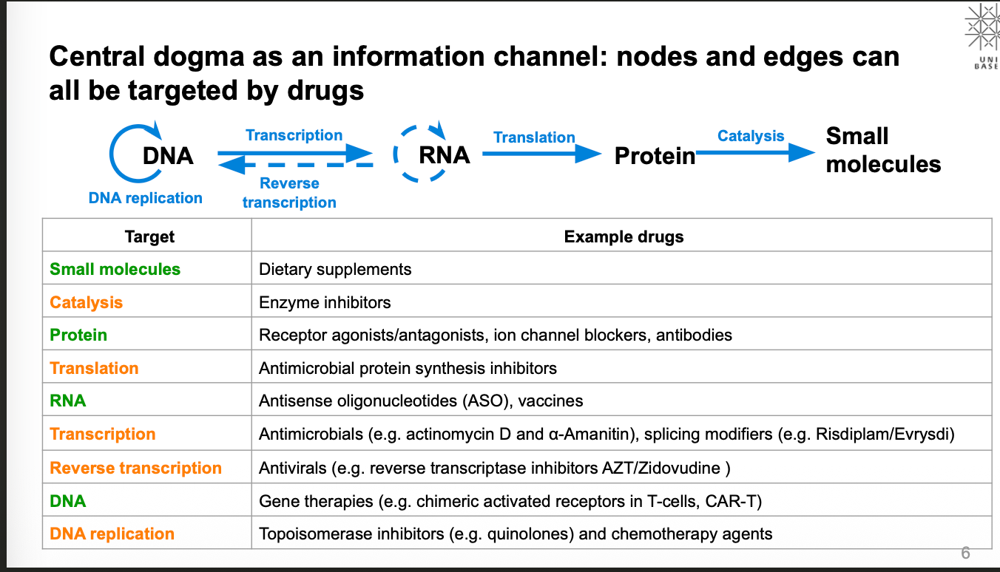
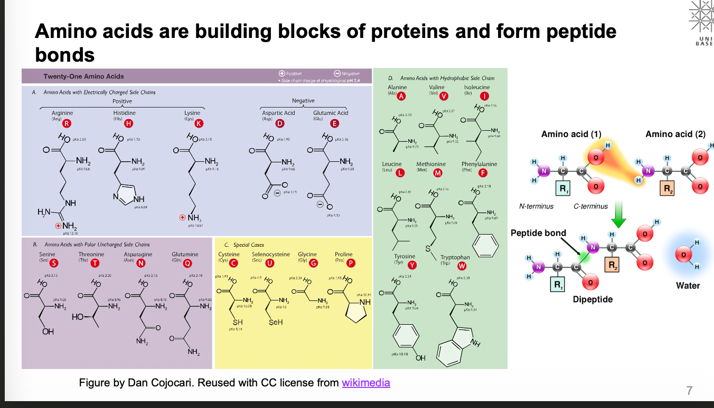
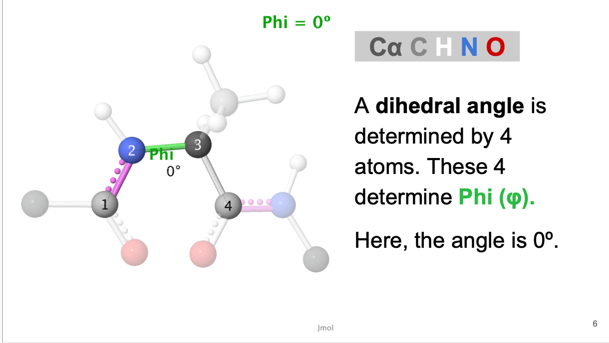
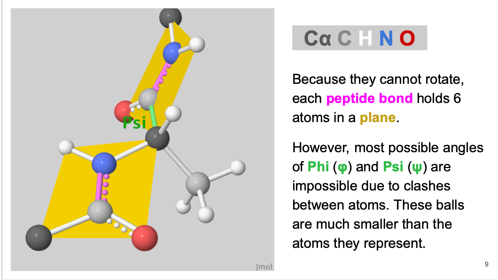
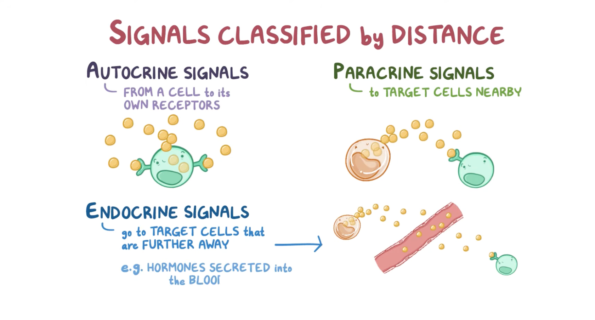
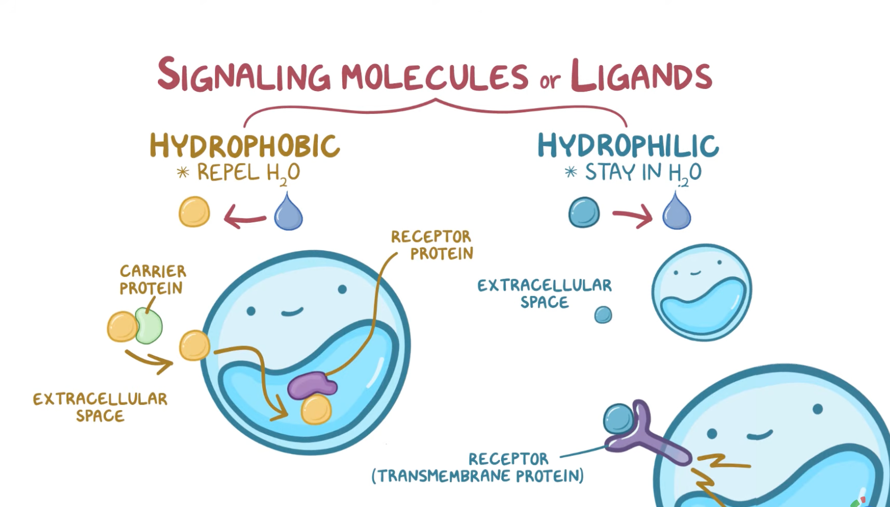
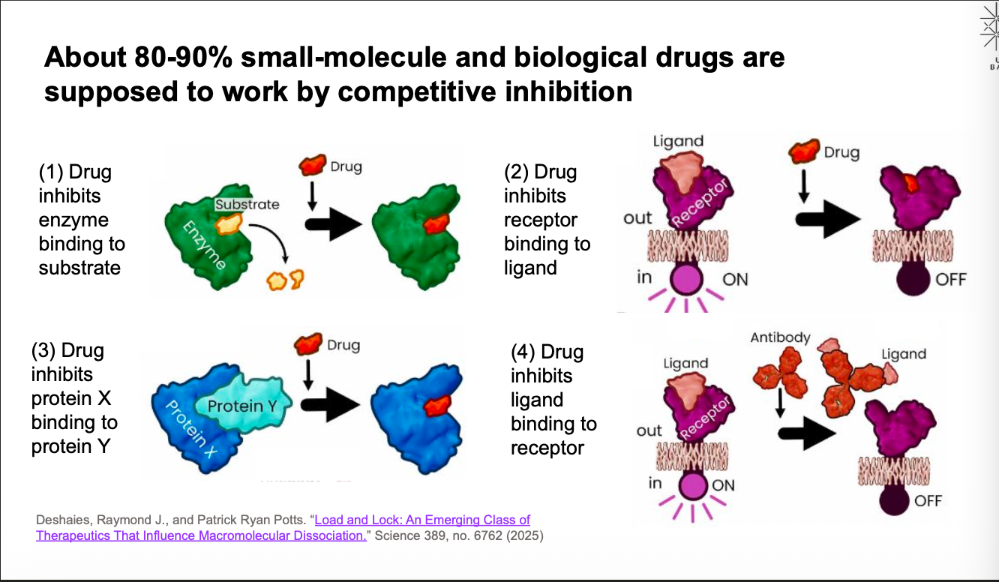
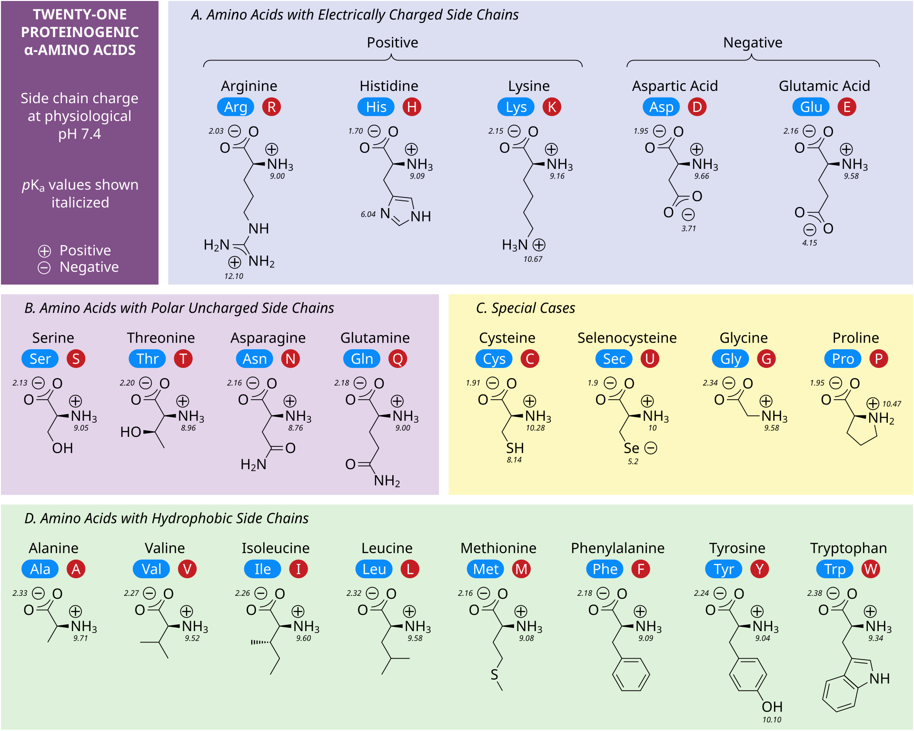
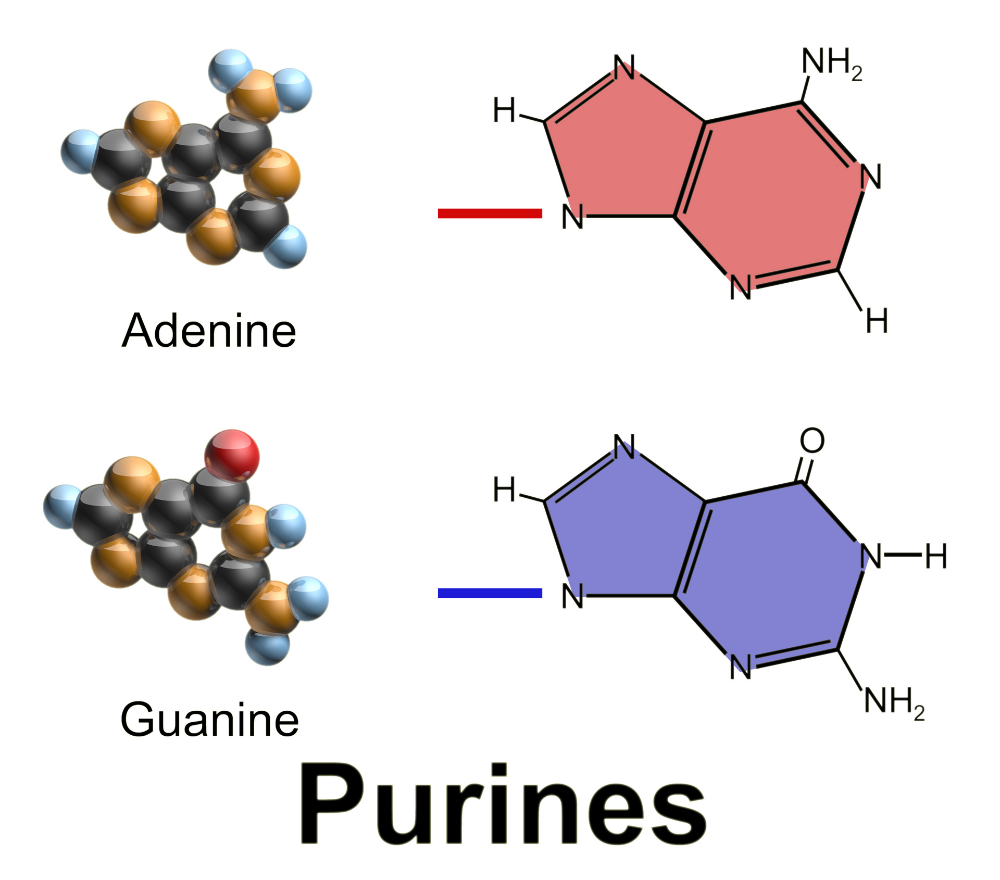
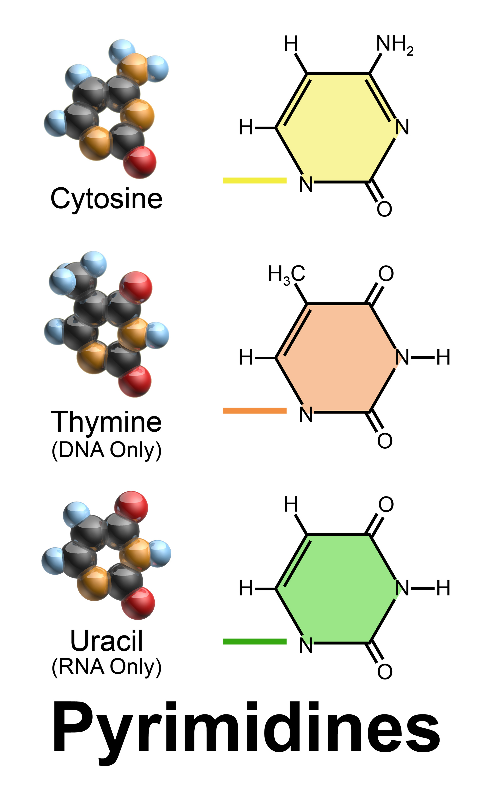

# AIMDD Lecture 5: Proteins as Drug Target

## Topics

- Protein, ligand and protein-ligand interaction,
- ODE-based mechanistic models,

## Central dogma as an information channel: nodes and edges can all be target by drugs

Five nucleobasis:
Adenine - Thymine
Cytosine - Guanine
Uracil (RNA)

 - [N] DNA (or **DNA replication**)
 - [E] The **transcription** or **reverse** **transcription** of DNA <-> RNA
 - RNA
 - [E] RNA **translation** to proteins
 - Proteins
 - [E] Protein **catalysis**
 - Small molecules

[E] : orange, [N]: green

Reverse transcription: enzymatic synthesis of complementary DNA (cDNA) from an RNA template, catalyzed by the reverse transcriptase enzyme. This happens in retroviruses, such as the HIV. When HIV infects a cell, it releases its RNA into the cytoplasm. The **viral** reverse transcriptase enzyme then reads the RNA and generates a DNA copy, which is then integrate into the cell's genome.

## Amino acids are the building blocks of proteins and form peptide bonds

[**Organic Chemistry note**: the lines represent carbon atoms. There are implicitly 2 H per carbon. 

- Ane: single (covalent) bond between C. Example: pentane
- Ene: double (covalent) bond between C. Example, hept-2-ene
- Yne: triple bond

The covalent bonds guarantee that the electron pairs are shared, thereby minimizing the system's potential energy. See also https://en.wikipedia.org/wiki/Orbital_hybridisation

Alkyl halides: when one of the halogen elements replaces a hydrogen in the carbon chain

Video number 13
]

Amino acids are organic compounds that contain both amino and carboxylic functional groups.

The peptide bond is formed between the C-terminus of AA 1 and the N-terminus of AA 2. The C-O-H connection in AA 1 matches with the H2 - N of AA 2, dropping H2 - O and creating a connection C - N - H. 

- The **electrophile**: The carbon atom in the carboxyl group (-COOH) of AA1 is double-bonded to an oxygen atom (the second one). Since oxygen is highly electronegative, it pulls the electron density from the carbon, making the carbon in the carbonyl group electron-deficient (an electrophile).
- The **nucleophile**: The nitrogen atom in the amino group (-NH2) of AA2 possesses a lone pair of electrons. (Prior to the reaction, the nitrogen atom is sp3 hybridized. Its valence shell contains five electrons; three form sigma bonds (2 with H, 1 with carbon), with 2 electrons occuping the fourth sp3 orbital as a non-bonding lone pair)
- The nucleophile connects with the electron-deficient carbonyl.
- The system collapses back to a stable state by expelling the hydroxyl group from the carboxyl carbon and one proton from the nitrogen, in what is called a dehydration reaction (see https://en.wikipedia.org/wiki/Dehydration_reaction)

### Primary structure of proteins

- Human proteins are just chains of amino acids (AAs). The backbone remains the same (the amino group (composed of 2H-N), as well as the acidic carboxyl group (composed of a O=C-O-H)) while the side chain varies among AAs.
- Proteins are called polypeptides since they are formed by peptide bonds.
- C-Ca bonds and Ca-N (between the amino group and the R group) bonds can rotate at to dihedral angles, \psi and \phi, respectively.
- These are main-chain backbone bonds.
- A dihedral angle is determine by 4 atoms. 
- \phi is defined by 4 atoms (C1 , N2, Ca3, C4), see attached example where \phi is zero 
- Due to steric collisions, only a subset of combinations of \psi and \phi is possible.

### The Ramachandran Principle

**Alpha helices, beta strands and turns are the most likely conformations for a polypeptide.** This is because the 3D conformation of protein backbone is strictly limited by steric hindrance between adjacent atoms.

- The **peptide bond is rigid and planar** (because they are partial double bonds), so a protein's flexibility depends on the rotation of two bonds connected to the alpha carbon; the N-Ca bon (\phi) and the Ca - C bond (\psi).
- Because atoms possesss finite van der Waals radii, the vast majority of (\phi, \psi) pairs are not physical, as they cause collisions between atoms. The allowed regions corresponds to \alpha helices and \beta sheets.
- The peptide bonds hold 6 atoms in a plane

Check quiz here https://proteopedia.org/w/Category:Pages_with_quizzes

### Proteins bind tightly to other molecules

- (Protein - Protein) GLP1R to Glucagon,
- (Protein - RNA) FMRP - RNA,
- (Protein - DNA) Fos:Jun - DNA,
- (Protein - Small molecules)  CYP3A4 and Caffeine

### Major protein classes by functions

- **Enzymes**,
- **Transporters**,
- **Receptors** and **kinases**,
- **Structural** proteins,

### Enzymes

An enzyme is a type of protein that catalyzes a chemical reaction. It:

1. initiates the reaction,
2. speeds up the reaction progress,
3. guarantees consistency of the outcome,

They can work together in larger cycles, for example, the citric acid cycle one.

An enzyme acts as a template by binding to the substrates, holding them in the correct position to allow the reaction to occur. It also surrounds the substracts with reaction groups which stabilize the transition state, making it easier for the reaction to occur. 

The shape of an active site is often flexible.

### Transporters

Moving ions, small molecules and proteins across membranes. Cell transport is done in two ways:

1. Passive. No energy input required (for example, diffusion, high -> low concentration),
2. Active. Moving from low to high concentration via protein pumps.

### Receptors and kinases

These propagate signs to the cells, allowing them to adapt to the environment and communicate between each other.

Types of signals
1. Autocrine,
2. Paracrine,
3. Endocrine,

3 stages of signaling pathway

1. Reception
2. Transduction -> transmembrane receptors: - G-protein coupled, enzyme coupled, ion channel 
3. Cell response

### Some diseases are caused by changes in a single protein

1. The mutation of glycine to cysteine in the Ras protein leads to protein that is continually activated, since it modifies the interaction with GDP and GTP (Guanosine Diphosphate and Triphophaste), which act as a switch turning the protein on/off,
2. Tumor necrosis factor promotes inflammatory response in autoimmune diseases

### About 80-90% of small-molecule and biological drugs work by competitive inhibition

1. **Drug inhibits the enzyme** from binding to the substrate, by taking the latters place,
2. **Drug inhibits receptor** binding to ligand,
3. **Drug inhibits protein** X binding to protein Y,
4. **Drug inhibits ligand binding** to receptor. In this case, the ligand cannot connect to the receptor because it has connected with something else.

### Methotrexate is a competitive inhibitor of Dihydrofolate Reductase (DHRF)

The **protein**: DHFR converts dihydrofolic acid into tetrahydrofolate. This process is important for cell proliferation and growth, so DHFR is a drug target for cancer and autoimmune diseases.
The **natural substrate**: Dihydrofolic acid is the natural ligand of DHFT.
The **drug**: Methotrexate (MXT) is a synthesized ligand of DHFT, and it is a competitive inhibitor of DHFR.
The **binding site**: Where the enzyme binds its substrate and catalysis the chemical reaction.

Inhibiting the pocket results in:

**Synthesis Arrest**
Because the receptor is occupied, DHFR cannot execute the catalytic reduction of dihydrofolic acid, cutting off the cellular supply of tetrahydrofolate (THF).

**Nucleotide Depletion**
THF is a mandatory cofactor for the *de novo* synthesis of purines and pyrimidines (specifically thymidine). Without THF, the cell cannot synthesize the basic nucleotide building blocks of DNA and RNA.

### Sotorasib, Pertuzumab, Trastuzumab: examples of small and large molecules inhibiting signaling

1. Sotorasib binds covalently to the sulfur atom in cysteine 12 of the Ras protein, blocking its action.
2. Pertuzumab and Trastuzumab

### How is a receptor occupied by varying concentrations of drugs?

Considering ligand binding as a reversible reaction: 

L + R -> (k1) LR, LR -> L + R (k2),

the dynamics are then described by the ordinary differential equation

d(LR)/dt = k1 L * R - k2 (LR)

This is the law of mass action: the rate of the chemical reaction is directly proportional to the product of the activities or concentrations of the reactants.

which has the steady state solution in terms of R_{total} = R + LR

LR = R_{total} (L)/(L + k_d),

with k_d = k_2/k_1. This is the Hill-Langmuir function. k_d is the dissociation constant and represents both the ration of reaction speeds and the concentration required to occupy half of the receptors.

### The thermodynamic interpretation

k_d is directly associated with the free energy of the reaction:

ln k_d = Free energy delta / RT

As the free energy delta -> \inf, then k2/k1 -> \inf (very large k2), meaning that LR -> 0 (in other words, the ligand does not bind)

### Lotka-Volterra equations

### SIR model of epidemiology

Models population behavior of viral infection and recovery

### ODE-based mechanistic models are often used in pharmacokinetic modelling

- PK describes how the drug is absorbed, distributed, metabolised and excreted by the body.
- A basic mathematical model for it is a compartment model: one or more ordinary differential equations that describe the relationship between drug concentration and time.

### (Backup slides) Why drug discovery?

https://www.nature.com/articles/nrd.2018.14

### Heceptin

1. What is the indication of Herceptin? What is its generic? Trastuzumab
2. What is the gene target? HER2 protein
3. Which class best describes the target? Enzyme, Ion channel, receptor or kinase? Receptor
4. In which year was the target of Herceptin described? When was Herceptin approved? 1988, 2026
5. What was the improvement of Herceptin compared with earlier antibodies? That is humanized (90% human), reducing rejection
6. Why does a biomarker matter besides developing drugs? Designing test group
7. In the clinical trial of Herceptin for metastatic breast cancer, how much improvement in the median survival rate did Herceptin achieve? From 20.3 to 25.4 months
8. And how much in the adjuvant setting? Time in remission doubled

HER2 gene - thought to be associated with accelerating the growth of breast cancer
 
Herceptin: (humanized) monoclonal antibody.

Slide 35: Free energy change equals the sum of entropic and enthalpic changes. Forming a complex reduces entropy: highly favorable enthalpic contacts between the protein and the ligand and therefore necessary.

Small differences in G translate to huge difference in the dissociation constant, which means that a computation model must have very high accuracy (on \Delta G) to predict K_D well.

## Saved link previews

- [Dehydration reaction - Wikipedia](<https://en.wikipedia.org/wiki/Dehydration_reaction>)
- [Orbital hybridisation - Wikipedia](<https://en.wikipedia.org/wiki/Orbital_hybridisation>)
- [Unexplored therapeutic opportunities in the human genome \| Nature Reviews Drug Discovery](<https://www.nature.com/articles/nrd.2018.14>)

## Images

