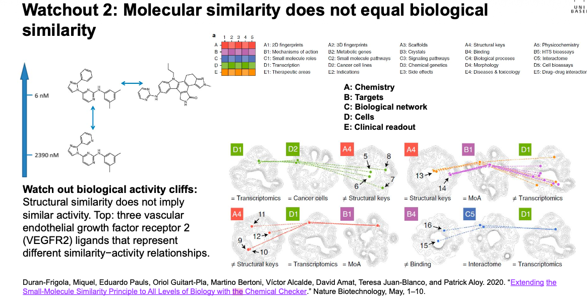
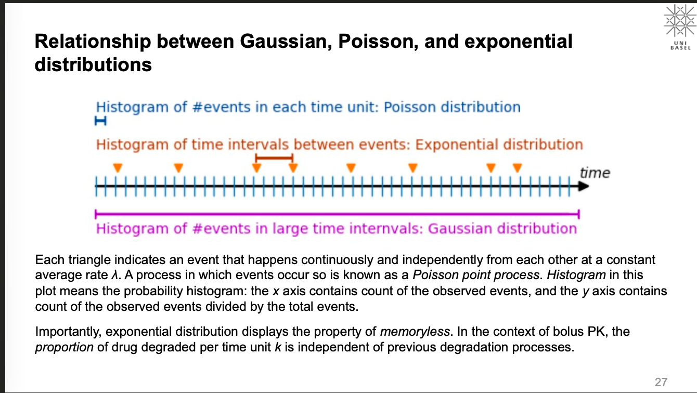

# AIMDD Lecture 6: Statistical Models and Causal Inference

Statistical models:

1. ODE-based mechanistic models,
2. Quantitative Structure-Activity Relationships (QSARs). Example: Free-Wilson analysis - the biological activity of a drug is a linear function of the activity of its structural components.

### Temporal validation is essential for drug discovery

Because chemical structures used in the training set may differ substantially from those that will be tested.

### Molecular similarity does not equal to biological similarity

The arrow represents the biological **potency** (specifically, the binding affinity or 
IC50) of the compounds against the target receptor, VEGFR2.
The blue arrow pointing upwards represents an increase in potency. A lower nanomolar value (6 nM) means the drug is more potent, requiring less concentration to shut down the receptor. A higher value (2390 nM) means the drug is weaker.

**1. Top to bottom: Activity**

The two molecules with different potencies are nearly 99% identical, sharing the same atomic mass, footprint, and functional groups. The *only* difference is a single nitrogen atom in the central six-membered ring. In the bottom-left molecule, that nitrogen atom has been shifted over by one position (a medicinal chemistry technique called a "nitrogen walk").

A nitrogen walk involves taking an aromatic ring system in a lead molecule and systematically moving a nitrogen atom from one position in the ring to the next (by replacing a carbon atom -CH with a nitrogen atom), generating a distinct series of structural analogs (e.g., shifting from a 2-pyridine, to a 3-pyridine, to a 4-pyridine). This introduces a very electronegative atom with a non-bonding pair of electrons, which act as an hydrogen bond acceptor. This also works for metabolic stability (CPY450).

VEGFR2 is a kinase. Kinase inhibitors must form highly specific, directional hydrogen bonds with a region of the protein called the "hinge". By moving the nitrogen atom by just 1.5 Angstroms, the molecule's electrostatic vector changes. It can no longer form the required hydrogen bond with the hinge. The enthalpy (ΔH) of the system fails to overcome the desolvation penalty.

**2. Left to right: Scaffold hopping**

Look at the top-left molecule and the top-right molecule of the slide 20 figure.
These two molecules possess zero structural similarity. The top-left is a small molecule. The top-right is a polycyclic structure. Despite having completely different 2D chemical structures, their biological potency is identical: both inhibit VEGFR2 at exactly **6 nM**.

This phenomenon is called **Scaffold Hopping**. Biological targets do not "see" the 2D skeleton of a drug; they only feel a 3D electrostatic surface. Although these two molecules look completely different, their underlying scaffolds project the necessary hydrogen-bond donors, acceptors, and hydrophobic vectors into the exact same spatial 3D coordinates inside the receptor's binding pocket.

Chemical checker: https://doi.org/10.1038/s41587-020-0502-7

### Correlation is either caused by causation or confounding

Statistical models alone cannot derive causality from correlation; the example being that, based only on R^2, one cannot say which of the variables causes the other.

One can learn about causality by:

1. listing models explicitly,
2. manipulating a variable and observing the outcomes

Red stars would support model 1, since manipulating the value of X would bring the values of Y lower (if X causes Y). Blue crosses would support model 3 since this change does not impact the causal u. Same thing for model 2, as a change in X does not impact Y.

### Conclusions

1. Structure similarity does not warrrant activity similarity,
2. Correlation can be caused by: 1) causation, 2) confounding, 3) coincidence, 4) conspiracy, 5) collider, 6) chronology.

### Relationship between Gaussian, Poisson and exponential distributions

(Probability) Histogram - x axis: count of observed events, y axis: count of observed events divided by total events.

Each triangle indicates an event that happens continuously and independently from each other at a constant average rate \lambda. A process in which events occur so is known as a Poisson point process. 

The histogram of the number of events in each time unit follows a Poisson distribution. 
The histogram of time intervals between events follows an exponential distribution. This is memoryless: in the context of PK, the proportion of drug degraded per unit time k is independent of the previous degradation processes.
The histogram of the number of events in large time intervals follows a Gaussian distribution.

### Extra Material

*<u>The Environment and Disease: Association or Causation?</u>* by Austin Bradford Hill (1965)

In what circumstances can we pass from an observed association to a verdict of causation? 
In particular, does the frequency of an undesirable event B will be influenced by a change in the environmental feature A?

What aspects of an association should be considered before deciding that causation is the likeliest explanation?

1. **Strength**: The death rate from lung cancer in cigarette smokers is 9-10x the rate of non-smokers. The rate for heavy cigarette smokers is 20-30x. On the other hand, the death rate from coronary thrombosis in smokers is no more than 2x (possibly less) the death rate of non-smokers. Though there is good evidence to support causation, one can think of other features of life that go hand-in-hand with smoking (confounders), as lack of exercise, diet, etc... 

In this regard, using ratios to understand strength of an effect for certain subsections of the population can be more indicative than looking at the overall value alone (examples of lung cancer in doctors given smoking, cholera epidemic given water quality).

However, we must not be too ready to dismiss a cause-and-effect hypothesis merely on the grounds that the observed association appears to be slight.

2. **Consistency**: Has the association been repeatedly observed by different persons, in different places, circumstances and times?

Whether chance is the explanation or whether a true hazard has been revealed may sometimes be answered only by a repetition of the circumstances and the observations.

3. **Specificity**: If the associated is limited to specific workers, sites and types of disease and there is no association between the work and other modes of dying, then this is a strong argument in favor of causation. If other causes of death are raised 10, 20 or even 50% in smokers, whereas cancer of the lung is raised 900-1000%, there is specificity (in this case, in the magnitude of the association). One must keep in mind though that diseases may have more than one cause. Multi-causation is generally more likely than single causation though, if one knew all the answers, one could go trace it back to a single factor.

4. **Temporality**: This is a question which might be particularly relevant with diseases of slow development.

5. **Biological gradient**: If the association can reveal a dose-response curve, this should be carefully investigated. For example, the fact that the death rate from lung cancer rises linearly with the number of cigarettes smoked daily.

6. **Plausibility**: It is helpful if is plausible, but this cannot be required, since plausibility depends upon the biological knowledge of the day. "When you have eliminated the impossible, whatever remains, however improbable, must be the truth."

7. **Coherence**: On the other hand, the cause-and-effect interpreation of our data should not seriously conflict with generally known facts of biology.

8. **Experiment**: Because of an observed association some preventive action is taken. Does it in fact prevent? This is one of the strongest supporters of causation.

9. **Analogy**: In some circumstances it might be fair to judge by analogy.

None of these 9 viewpoints can bring indisputable evidence for or against the cause-and-effect hypothesis and non can be required as a sine qua non. 

*<u>Exposure to sugar rationing in the first 1000 days of life protected against chronic disease</u>* by Gracner, Boone and Gertler (Science, 2024). Use the example to check whether the evidences and conclusion meets Hill’s criteria of causality, including (1) strength, (2) consistency, (3) specificity, (4) temporality, (5) biological gradient, (6) plausibility, (7) coherence, (8) experiment, and (9) analogy.
Submit the answers to the form for the offline activity of lecture 6 [Form URL to be updated]. Deadline: EOB, Thursday before lecture 7.

(Optional) If you are intrigued by the findings of the study, and/or if you are interested the hypothesis of *fetal origins of disease* in the cardiovascular domain, please read *<u>Exposure to sugar rationing in first 1000 days after conception and long term cardiovascular outcomes: natural experiment study</u>* by Zheng *et al.* (BMJ, 2025).

## Saved link previews

- [Extending the small-molecule similarity principle to all levels of biology with the Chemical Checker \| Nature Biotechnology](<https://www.nature.com/articles/s41587-020-0502-7>)
- [Exposure to sugar rationing in the first 1000 days of life protected against chronic disease](<https://www.science.org/doi/10.1126/science.adn5421>)
  We examined the impact of exposure to sugar restrictions within 1000 days after conception on type 2 diabetes and hypertension, leveraging quasi-experimental variation from the end of the United Kingdom’s sugar rationing in September 1953. Rationing ...

## Images

