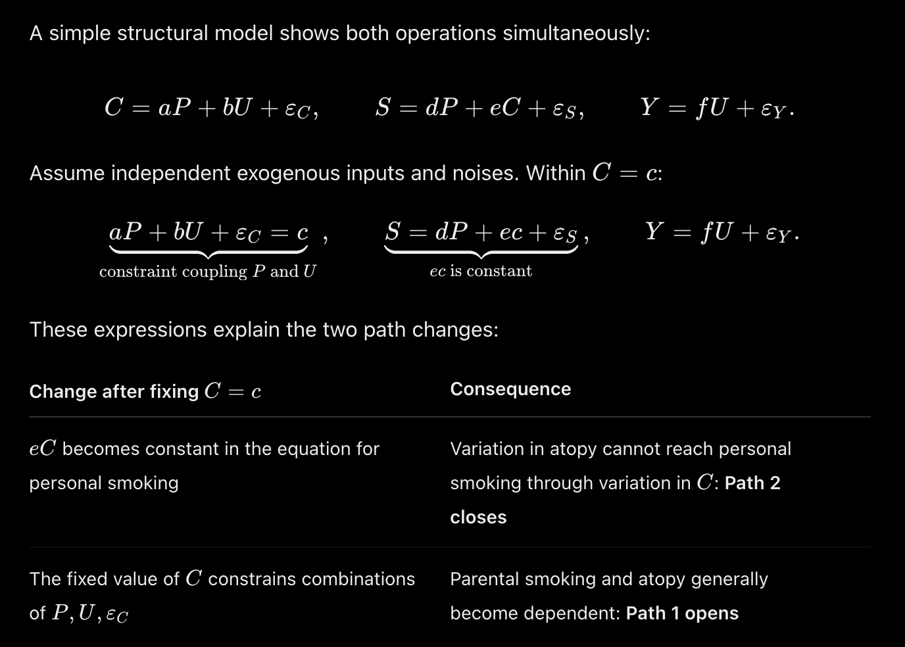
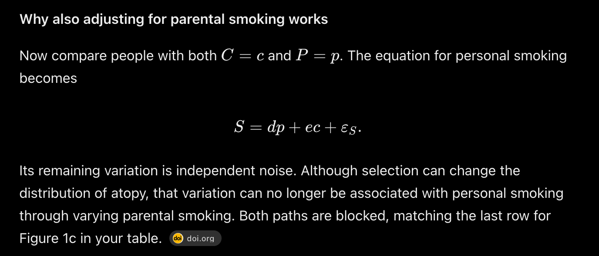
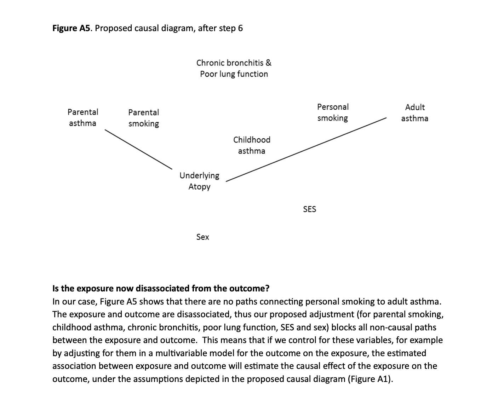
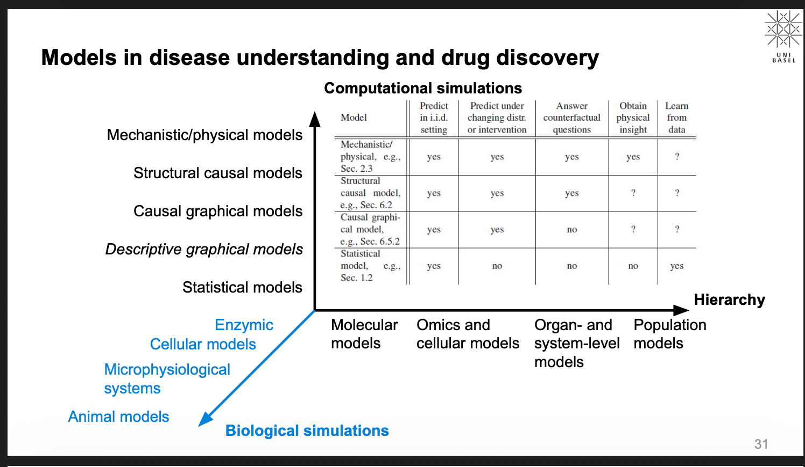

# AIMDD Lecture 7/8: Causal Inference

## Lecture 7

Based on Hill's criteria to ascertain causation from correlation:

1. strength
2. consistency
3. specificity
4. temporality
5. dose response
6. plausibility
7. coherence
8. experiment
9. analogy
10. reversibility

Correlation can be caused by

- coincidence
- causation (the true effect)
- a confounding effect (a common cause)

Statistical models alone, however, cannot derive causality from correlation.

### How to learn about causality?

1. Listing models explicitly
2. Manipulating an input variable and observing the outcomes.

### Common DAG structures: 1) the pipe

X -> Z -> Y (x causes z and z causes y)

[Slide 10] Conditioning on the mediator X means that X does not provide any additional information about Y. E.g, all the relevant information from X has already been captured by Z:

Y = \alpha + \beta_x X + \epsilon , \beta_x ~ 1.5 (as in fig 3 of slide 9)
Y = \alpha + \beta_x X + \beta_y Y + \epsilon  , \beta_x ~ 0

### Common DAG structures: 2) the fork

Z causes both X and Y. Generative model:

- Z is a random variable = 0, 1
- Both X and Y are random variables following Gaussian distribution with mean equal to Z

Because their data generation is identical, X and Y have similar distributions (e.g, they are both children of a common cause and therefore correlated). However, this disappears when conditioning in the common cause. See script.

### Common DAG structures: 3) the collider
 
X and Y both cause Z. Generative model:

- X and Y are random variables , N(0,1)
- Z = 1 if X+Y > 0 , -1 if X + Y <= 0

Note: conditioning on the collider introduces spurious correlations.

To infer causality, models (knowledge + assumptions) are required.

### (Detour) Respirology: Introduction to Causal Diagrams

See from https://onlinelibrary.wiley.com/doi/epdf/10.1111/resp.12238

Confounders are variables which are:

1. associated with the exposure in the source population,
2. associated with the outcome along the unexposed,
3. not on the causal pathway,

From a DAG perspective, these are the common cause between exposure and outcome (for Figure 1a, it is childhood asthma). For example, childhood asthmatics may be less likely to smoke but more likely to have adult asthma. In this case, an unadjusted comparison of smokers (a small proportion of which were childhood asthmatics) and non-smokers (a larger proportion of which were childhood asthmatics) would falsely conclude that non-smokers have a higher risk of asthma.

Causal diagrams explicitly separate the concepts of causation and association. The underlying causal structure shown in the causal diagram inform us about which statistical associations between the variables in the diagram are present, **assuming** that the diagram correctly depicts the underlying scenario. This allows us to form valid estimates of causal effects from the observed associations (either unadjusted or adjusted for measured data) in our data.

Using the causal diagram, we can:

1. decide whether (under the assumptions) an unadjusted comparison of the outcome between exposed and unexposed participants will be a biased estimate of the causal effect of the exposure on the outcome,
2. determine whether spurious (non-causal) exposure-outcome association is present. If it does not, then the unadjusted comparison will be unbiased.

In causal diagrams, a **path** from the exposure (personal smoking) to the outcome (adult asthma) is a series of arrows connecting the exposure and outcome, irrespective of the direction of arrows.

A **causal path** from the exposure to the outcome is a path starting at the exposure in which each arrow is followed from tail to head until it reaches the outcome
(e.g. personal smoking → bronchial hyperreactivity → adult asthma).

Figure 1b: childhood asthma is a collider. In epidemiological terms, it is a common effect (of parental smoking and atopy).

Importantly, association is **not** transmitted across collider variables; just because two factors share an effect does not mean that they themselves are associated.

Paths in causal diagrams are either:

- open (they transmit association),
- closed (they do not).

An unadjusted comparison of the outcome between exposure groups will be unbiased iif all non-causal paths between the exposure and outcome are closed.

- In Fig. 1a, the single non-causal path from personal smoking to adult asthma is open, so the unadjusted analysis is biased (see above),
- In Fig. 1b, the single non-causal path from ... to ... is closed, so the ... is unbiased.
- In Fig. 1c, there are two non-causal paths. One (personal smoking ← parental smoking → childhood asthma ← atopy → adult asthma) contains a collider variable (childhood asthma), the other one (personal smoking ← childhood asthma ← atopy → adult asthma) does not. Path 1 is therefore closed and 2 is open. Because path 2 is open, spurious association exists between personal smoking and adult asthma. As a result, an unadjusted analysis will be biased.

If an unadjusted comparison of the outcome between exposure groups gives a biased estimate of the causal effect of the exposure, it may be possible to remove the confounding bias by performing an analysis adjusting for a set of measured variables. We would fit a multivariable (logistic) regression model for the outcome, including the exposure and the selected measured variables as explanatory variables.

Under Fig. 1a, we have seen that the unadjusted analysis is biased because there is an open non-causal path from personal smoking to adult asthma. This path is closed by adjusting for childhood asthma.

Under Fig. 1b, if we decide to adjust for childhood asthma (the collider variable), we would open the non-causal path between personal smoking and adult asthma, creating spurious exposure-outcome association and introducing bias. Example of deterministic atopy/parental smoking: if either happens, the child will have asthma. In this case, after adjusting for childhood asthma, parental smoking provides information about atopy status and vice-versa; the two characteristics are (now) strongly associated. This is called M- or collider-stratification bias.

Under Fig. 1c, both non-causal paths are simultaneously closed only when both childhood asthma and parental smoking are adjusted for (see images). 

Fixing a common effect constrains its causes, fixing a non-collider prevents variation from being transmitted through that node along the path.

The conclusion, from the confounder selection process described earlier, will sometimes be that no set of measured variables is sufficient to remove confounding bias. If it is not possible to perform more data collection to solve the problem, any statistical analysis of the data must be cautiously interpreted in light of unmeasured confounding variables.

Adjustment set - a set of measured variables such that adjustments for these will ensure all non-causal paths between exposure and outcome are closed:

1. Check variables in adjustment set are not caused by exposure,
2. Remove irrelevant variables from the causal diagram (no causal effect on outcome, exposure, or adjustment set),
3. Remove causal effects of the exposure,
4. Mark associations induced by adjusting for collider variables (e.g, add an undirected line between variables that share a direct effect),
5. Remove arrow directions,
6. Delete lines touching the adjustment set,
7. Is the exposure now dissociated from the outcome? Y (All non-causal exposure-outcome paths are closed)/N (Some spurious exposure-outcome association remains)

Because Fig. 4 is just an extension of Fig. 1c, parental smoking and childhood asthma have to be adjusted for. Chronic bronchitis/poor lung function, SES (Socio-Economic Status) and sex play a similar role to childhood asthma in Fig. 1a; since they are the only variable in an open non-causal path that contains no collider variables, they have to be adjusted for.

## Lecture 8

Starting from page 19

Pipe: x -> z -> y : drink coffee (X) -> caffeine enters the bloodstream (Z) -> harder to fall asleep (Y). Coffee intake causes caffeine to rise, which stimulates the brain and blocks sleep-promoting signals.

Fork: x (going on daily walks) <- z (owning a dog) -> y (frequently visiting the park)

Collider: x (technical skill) -> z (job offer) <- y (personal charm/connections)
x (rain) -> z (wet grass) <- y (sprinker)

### Does pharmaceutical modulation of neurogenesis benefit pattern separation?

- What is spatial pattern separation? A neural computation that makes similar inputs produce more distinct representations, reducing interference between memories.
- The authors claim that running impacts this. What is the hypothesis? Running -> more adult-born dentate-gyrus neurons -> better separation of similar spatial representations -> better discrimination
- The last chart shows neuron density as a function of reversals and apparently, a linear correlation. What are these variables and why are they linearly correlated?

Two models:

1. Neurogenesis-dependent model (pipe): treatment (exercise vs control) -> neurogenesis -> behavior (pattern separation). This suggests that, conditioned on neurogenesis, exercise and behavior are independent.
2. Neurogenesis-independent model (fork): neurogenesis <- treatment -> behavior. This suggests that, conditioned on exercise, neurogenesis and behavior are independent.

Behaviour and neurogenesis display negative correlation when conditioning on exercise (similar to slide 12). Causal inference reduces bias in the analysis by listing models explicitly.

### Causal inference is important for both randomized experiments and observational studies

- counterfactuals are important: what if the patient received the alternative treatment, keeping everything else constant?
- randomized experiments and controlled trials are gold-standard methods to address causal questions. Non-compliance and intermittent events call for causal analysis of the data even in randomized trials.
-- non-compliance/adherence means that the treatment is not followed (skipping doses, or taking a different dose, stopping treatment)
-- intermittent/intercurrent events occur after treatment beings and affect either the interpretation or the existence of the outcome being measure (death, treatment discontinuation, ...)
- given causal models, it is sometimes possible to learn causal relationships from observational data as well

### Ten simple rules of causal inference

1. Clarify whether correlation or causation is of interest,
2. Draw models of knowledge, assumption and data-generation processes as graphs,
3. Formulate the causal question by identifying the target estimand,
4. Collect, check the quality of, and filter data,
5. Model the causal effect,
6. Challenge and refute model,
7. Compare results with estimates from alternative models,
8. Share model, data, analysis,
9. Design, perform and analyze new experiments,
10. Apply learnings from causal inference in the real world

## Good/Bad Controls Crash Course (Judea Pearl)

See important definitions on mediators (chains), common causes (forks) and common effects (colliders), as well as the effects of conditioning/controlling for/on a descendant of a variable in the Appendix below.

If we are interested in estimate the causal effect of X on Y, our task is conceptually simple: we must block all spurious paths between X and Y, and we most not perturb any of the causal paths between them. This will be our guiding principle for deciding whether or not Z should be included in the regression equation.

### Illustrative Examples

Target: Average causal effect (ACE) of a treatment (X) on an outcome (Y); the expected increase of Y in response to a unit increase in X due to an intervention.

- black: observed variables,
- white: unobserved,
- red (Z): variable whose inclusion in the regression equation is to be decided:
-- "good control" = bias reduction,
-- "bad control" = bias increase,
-- "neutral control",

Models 4,5,6 (Good controls): When considering possible threats of confounding, modelers have to keep in mind that common causes of X and any mediator between X and Y also confound the effect of X on Y.

Model 7 (Bad control): Controlling for Z (which is actually a confounder) will open a back-door path X <- U1 -> Z <- U2 -> Y, thereby spoiling a previously unbiased estimate of the ACE.

Model 8 (Neutral control)

Model 9 (Neutral control): As a general rule of thumb, parents of X which are not necessary for identification are harmful for the asymptotic variance of the estimator (Model 9); OTOH, parents of Y which do not spoil identification are beneficial (Model 8)

Model 10 (Bad control): Bias amplification (the model from slide 28 of Lecture 7-8). Naive control for Z will not only fail to deconfound the effect of X on Y, but, in linear models, amplify any existing bias.

### Appendix

The structural causal model (SCM) M induces a joint distribution on the endogenous variables P(V), denoted observational distribution.

### Interventions and causal effects

Interventions are modeled by modifying mechanisms of the SCM. The act of fixing X=x (e.g, do(X=x)) in Fig.14a amounts to replacing the original mechanism, X <- f_x(Z, U_x) with a new mechanism in which X is externally forced to the value X, X <- x, resulting in a modified SCM.

This new model induces an interventional distribution on the endogenous variables, denoted by P(V|do(X=x)). We can now defined the average causal effect (i.e, the expected increase of Y in response to a unit increase in X due to an intervention) as the average contrast of Y under two distinct interventions, ACE(x) = E[Y|do(x+1)] - E[Y|do(x)].

### Potential outcomes

Potential outcomes V_x are defined as the solution of the endogenous variables V in the modified model M_x. Therefore:

- P(V|do(X=x)) = P(V_x)
- ACE(x) = E[Y_{x+1}] - E[Y_x]

### Causal and non-causal paths: chains, forks and colliders

- Z <- U_z
- X <- \lambda_{zx}Z + U_x
- Y <- \lambda_{xy}X + \lambda_{zy}Z + U_y

U are normally distributed and the random variables X, Z, Y have mean zero and unit variance.

ACE(x) = E[Y|do(x+1)] - E[Y|do(x)] = \lambda_{xy}
\beta_{yx} = Cov(Y,X)/Var(X) = \lambda_{xy} + \lambda_{zx}\lambda_{zy}

ACE(x) != \beta_{yx}  because the observed association of X and Y mixes both the causal association (the path X -> Y) and the non-causal association due to the confounder Z (X <- Z -> Y). These confounding paths, starting with an arrow pointing to X, are also called "back-door" paths.

The regression coefficient of Y on X adjusting for Z (denoted by \beta_{yx,z}) evaluates to \lambda_{xy}; e.g, controlling for Z in this model effectively blocks the back-door path, recovering the ACE.

- Chains (mediators): X -> Z -> Y ; X causally affects Y through the mediator Z. Conditioning on Z in a chain blocks this flow of association.
- Forks (common causes): X <- Z -> Y ; X and Y share a common cause (a confounder) Z, which induces a non-causal association between both variables. Conditioning on Z in a fork blocks this flow of association.
- Colliders (common effects): X -> Z <- Y; X and Y share a common effect. Unlike the other patterns, this path is closed by default. Conditioning on Z opens the path and induces a non-causal association between X and Y.

Controlling for a descendant of a mediator or a confounder partially blocks the flow of association. Controlling for a descendant of a collider partially opens the flow of association.

A path p in a graph is blocked by a set Z IIF:

1. p contains a chain or a fork, such that the middle node is in Z,
2. p contains a collider, such that neither the middle node, nor any of its descendants, are in Z.

## Saved link previews

- [Introduction to causal diagrams for confounder selection](<https://onlinelibrary.wiley.com/doi/epdf/10.1111/resp.12238>)

## Images

