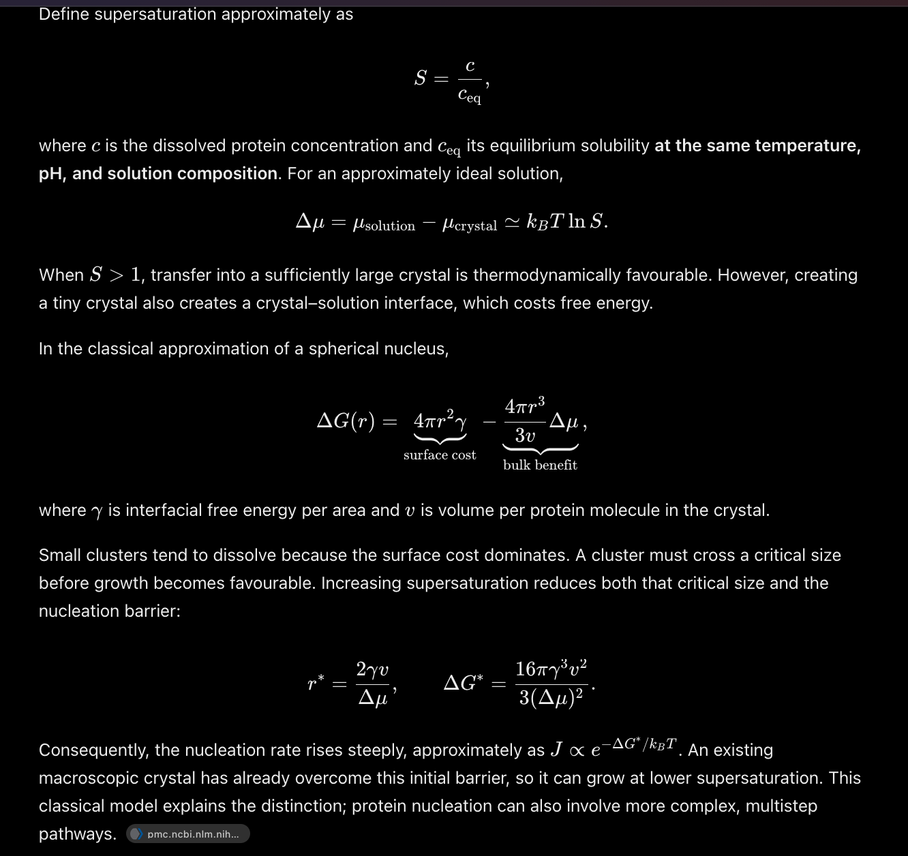
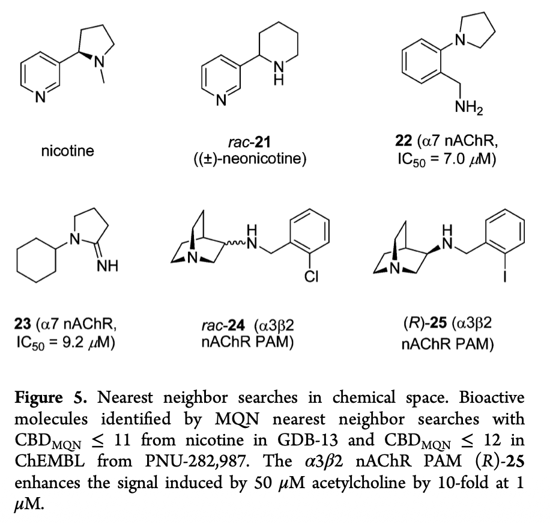

# Chemical Space Papers

## Snell: The application and use of chemical space mapping to interpret crystallization screening results

See [here](https://pmc.ncbi.nlm.nih.gov/articles/PMC2631111).

Macromolecular crystallization screening is an empirical process which involves setting up experiments with a number of different cocktails designed to sample chemical space known to promote crystallization. In other words, the chemical cocktails are designed to supersaturate the macromolecule.

At the HWI, the HTS laboratory steps up crystallization experiments in 1536-well experiment plates. Each plate contains a single common macromolecule solution arrayed with an equal volume of 1536 different crystallization cocktails. An automated imaging system records the experiments' outcomes 1d after the addition of the protein solution and weekly thereafter for four weeks.

These are analyzed manually with an in-house software package. There are 7 possible image categories:

1. crystal
2. precipitate
3. clear
4. phase separation
5. skin
6. unknown
7. garbage

Crystallization begins when the biochemical conditions promoting supersaturation of the macromolecule produce ordered aggregates. These ordered aggregates (e.g, nuclei) form in the labile zone; a higher level of supersaturation than required for crystal growth.

As the solution conditions change, the protein is sequestered in the nuclei; this can decrease the level of supersaturation and shift the conditions to a metastable region that supports crystal growth but not additional nucleation.

Crystallization is affected by more variables than macromolecule and precipitant concentrations alone and the effect of any single variable is often non-linear.

A macromolecule supersaturated in the metastable region will exhibit experimental results virtually indistinguishable from one in the under-saturated region. Both experiments appear as clear drops until a nucleation event occurs, yet the metastable region experiment is ideal for seeding and crystal growth.

One can still determine the distance of a clear drop to the metastable zone by checking the surrounding experiments.

3 primary variables (because they control protein solubility and protein-protein interactions):
- pH: influences the protein surface charge (via the protonation of amino-acid side chains) and contact chemistry,
- precipitating agents: change protein-solvent interactions and produce volume-exclusion effects, which can favour protein association and lower equilibrium solubility,
- inorganic salts: modify electrostatic screening and introduce ion-specific interactions,

### 2. Experimental

The current cocktails can be divided into 3 groups:

- salts (chemical compound consisting of positively charged ions (cations) and negatively charged ions (anions), bound together via ionic bonds),
- PEGs (polyethylene glycol, water-soluble polymers with repeating ethylene oxide units. This is used as a precipitating agent to promote supersaturation),
- commercial screen group,

### 4. Discussion

Crystallization cocktails are chemically related in space and therefore the results can be mapped and interpreted in that space. 

Another important aspect of mapping the results into chemical space is the ready identification of conditions that have not been sampled and the results surrounding those conditions. 

For example, if precipitation and clear results were seen along a chemical vector that included a large unsampled area of space, this would be a strong indication that this region is a candidate for exploration.

### 5. Conclusions

Representing crystallization results in chemical space quickly identifies optimization pathways and meaningful gaps in the sample chemistry. It allows the rapid visualization and interpretation of a complex experimental space.

### Relevant concepts

#### Labile zone

The labile zone is the range of solution conditions where supersaturation is high enough for new crystal nuclei to form at an appreciable rate during the experiment. At lower supersaturation—the metastable zone—an existing crystal can grow, but new nuclei rarely form.

Starting a crystal requires more supersaturation than growing a crystal because the surface cost plays a larger role than the bulk term (see attached images). Note that the critical size is inversely proportional to the log of S, the supersaturation.

#### Precipitant

A generic crystallization reagent. This changes the solution environment such that the protein is less soluble. Lowering its equilibrium solubility increases supersaturation.

#### DVR/T

Drop Volume Ratio/Temperature optimization. After finding a promising crystallization cocktail, protein and cocktail stock solutions are reused while varying their mixing ratio and incubating the resulting drops at different temperatures. The aim is to improve crystal size and quality without reformulating the cocktail.

### Images

## Reymond: The chemical space project

See [here](https://pubs.acs.org/achre4/article/48/3/722/1248286/The-Chemical-Space-Project)

GDB-17 contains 166.4 billion molecules of up to 17 atoms of C, N, O, S and halogens. Molecules allowed by valency rules but unstable or nonsynthesizable due to strained topologies were not considered.

POC applications of GDB for drug discovery were done by combining virtual screening with chemical synthesis and activity testing for neurotransmitter receptor and transporter ligands.

Lesson: Using GDBs in drug analog searches shows that millions of very close analogs of any molecule can be readily identified by nearest-neighbor searchs in MQN-space of the various GDBs.

### Introduction

Organic molecules are defined by the number, type, topological connectivity and stereochemistry of the atoms described in their structural formula. 

The "drug-like" chemical space has been estimated at $10^{60}$ for all molecules obeying Lipinski's rule-of-5 for oral bioavailability, and at $10^{20-24}$ for all molecules up to 30 atoms.

### Enumeration

Method: enumerate all possible molecules - to gain an unbiased insight into the entire chemical space - by taking only simple chemical stability and synthetic feasibility criteria into account.

Starting with mathematical graphs produced by GENG, one subselected graphs suitable for saturated hydrocarbons (accounting for ring strain and topology and excluding planar or pyramidal quarternary centers). 

These were then converted into skeletons by introducing unsaturations following valency, aromaticity and ring strain rules (for example, removing bridgehead double bonds and allenes). Molecules were then obtained by mutating carbon atoms to N, O, S and halogenes while taking functional group stability into account (for example, excluding water-reactive groups, all heteroatom-heteroatom bonds except within aromatic rings, oximes and hydrazones).

Most GDB moleculues are stereochemically rich, have intermediate polarity with a 3D-shape, the latter is rather rare in historical drugs but correlates well with clinical success of drug candidates. 

### A periodic system of molecules

To efficiently find analogs of molecules, these are assigned a fingerprint and placed at the corresponding coordinates of a multidimensional space where each dimension represents one of the descriptors. This Molecular Quantum Number (MQN) system uses 42 molecular quantum numbers counting relevant features for chemical structure and biological activity. 

The same principle was applied  with another five fingerprints providing different insights into molecular structure:

1. SMILES fingerprint (SMIfp) counting 34 characters appearing in the SMILES representation of a molecule,
2. 1024-bit binary Daylight type substructure fingerprint (Sfp),
3. Extended connectivity fingerprint (ECfp4) counting the presence of specific substructures,
4. Atom pair fingerprint (APfp), encoding molecular shape,
5. its related category extended atom pair fingerprint (Xfp) encoding pharmacophores.

For the case of MQN, SMIfp, APfp and Xfp fingerprints similarly retrieved "scaffold-hopping" analogs, which are molecules with a similar shape, pharmacophores and bioactivity but very different substructures as measured by Spf, indicating non-obvious and valuable structure-activity relationships. 

### Drug discovery

The majority of GDB molecules fulfill drug-likeness, lead-likeness and fragment-likeness criteria, mostly because graph diversity is highest with polycyclic rigid structures and because the introduction of heteroatoms gives the largest number of possibilities for intermediate ratios of heteroatom to carbon, resuling in many relatively rigid and polar molecules.

### Conclusion and outlook

Millions of very close analogs of any molecule are possible including scaffold-hopping molecular shape and pharmacophore analogs. These analogs can be readily identified by nearest-neighbor searches in MQN-space of the various GDBs.

### Questions

- What is the MQN-space?
- What is meant by hydrocarbon saturation/unsaturation?
- Why are planar/pyramidal quarternary centers, bridgehead double bonds and allenes, and heteroatom-heteroatom bonds unphysical?
- What is chemical space travel?
- Why does 3D drug shape correlate with clinical success?
- What are the 1024-bit binary Daylight type substructure, extended connectivity and atom pair fingerprints?
- What is the importance of polycyclic rigid structures for drug (lead)-likeness?
- What is the role of heteroatoms in drug-likeness?
- What is scaffold-hopping?

### Relevant concepts

These clarifications follow [Reymond's paper](../ai-ml-dd/reymond-molecular-chemical-space.pdf) and the references linked below; reference numbers refer to that paper.

#### MQN-space

MQN-space is a 42-dimensional space in which each molecule has integer coordinates counting atoms, bond types, polar groups and topological features such as rings. Nearby molecules have similar counts, even when their connectivity differs. Reymond searches for neighbors using city-block distance: the sum of absolute differences across all 42 coordinates. [van Deursen et al., 2010; ref. 74](https://doi.org/10.1021/ci100237q).

Each molecule is represented by a vector $\mathbf{m}=(m_1,\ldots,m_{42})$. A dimension is one structural count, rather than a physical spatial direction. The 42 counts fall into four categories:

| Category | Dimensions | What is counted | What it describes |
| --- | --- | --- | --- |
| Atom counts | 12 | Selected elements such as carbon, sulfur and halogens; separate counts of nitrogen and oxygen inside and outside rings; total heavy atoms (all atoms other than hydrogen). | Molecular size and elemental composition. |
| Bond counts | 7 | Single, double and triple bonds, each separated into cyclic and acyclic bonds, plus rotatable bonds. | Saturation, ring participation and flexibility. |
| Polarity counts | 6 | Hydrogen-bond acceptor atoms and sites, donor atoms and sites, and positive and negative charges. | Capacity for hydrogen bonding and ionic interactions. |
| Topology counts | 17 | Atoms grouped by their number of heavy-atom neighbors and ring membership; rings grouped by size; atoms and bonds shared by rings. | Branching, ring architecture and structural complexity. |

This grouping follows [Awale et al., 2013, Table 1; ref. 83](https://doi.org/10.1021/ci300513m).

Within the polarity category, an *atom count* records how many atoms can donate or accept hydrogen bonds, while a *site count* counts donor hydrogens or acceptor lone pairs according to the MQN rules. These counts depend on protonation; the cited GDB analysis uses the ionization state predicted at pH 7.4. [Blum et al., 2011, Table 1; ref. 72](https://doi.org/10.1007/s10822-011-9436-y).

The category sizes add to 42, but the counts are related: adding a carbon can change the carbon count, total heavy-atom count, bond counts and connectivity counts together. MQNs summarize a structure without recording every atom's exact connectivity or stereochemistry, so different molecules can occupy the same coordinates. A two-dimensional MQN map is a projection of the full descriptor space and can lose distinctions present in the original 42 coordinates.

Examples: if two fingerprints differ by 1 in one coordinate and 2 in another, with the other 40 equal, their distance is 3.

As a chemical example, ethanol and dimethyl ether both have two carbons, one acyclic oxygen and three heavy atoms, so their atom-count coordinates match. Ethanol's OH supplies a hydrogen-bond donor while the ether has none, separating them in the polarity coordinates.

#### Hydrocarbon saturation and unsaturation

A saturated hydrocarbon contains only carbon–carbon single bonds. Unsaturated hydrocarbons contain carbon–carbon double or triple bonds, including those in aromatic systems. Adding these multiple bonds to a fixed carbon skeleton reduces its hydrogen count. Saturated carbons are usually tetrahedral ($sp^3$), whereas alkene (double-bonded) carbons are approximately planar ($sp^2$) and alkyne (triple-bonded) carbons are linear ($sp$).

Examples: ethane ($\mathrm{C_2H_6}$) is saturated, while ethene ($\mathrm{C_2H_4}$) has a double bond. Cyclohexane is saturated despite containing a ring; although rings count toward the degree of unsaturation in molecular-formula calculations, they themselves do not make a hydrocarbon unsaturated.

#### Planar/pyramidal quaternary centers, bridgehead double bonds, allenes and heteroatom–heteroatom bonds

These exclusions combine geometric strain with conservative database filters; the excluded motifs are not all unphysical. [Ruddigkeit et al., 2012; ref. 38](https://doi.org/10.1021/ci300415d).

- Quaternary carbon centers have four carbon neighbors and normally approximately tetrahedral geometry. Cage topologies forcing planar or strongly pyramidal arrangements can impose severe strain.
- Bridgehead double bonds in small bridged rings force the alkene away from the geometry needed for good overlap of its $p$ orbitals (the basis of Bredt's rule). Larger ring systems can accommodate them.
- Allenes have consecutive double bonds, $\mathrm{C=C=C}$, requiring a linear central carbon and perpendicular terminal substituent planes. Small rings can prevent this geometry.
- Heteroatom–heteroatom bonds can introduce reactive groups, but many are stable. Reymond's enumeration retained exceptions within aromatic rings, oximes and hydrazones.

Examples: propadiene ($\mathrm{CH_2=C=CH_2}$) is a real, isolable allene. Dimethyl disulfide ($\mathrm{CH_3-S-S-CH_3}$) is a stable compound with a heteroatom–heteroatom bond.

#### Chemical space travel

Chemical space travel (CST) generates paths from a starting molecule A toward a target molecule B through repeated small structural mutations, such as adding, removing or changing atoms or bonds. Each cycle selects candidates by similarity to B, generating a library of intermediate structures. Note however that adjacent structures need not be connected by a practical chemical reaction. [van Deursen and Reymond, 2007; ref. 48](https://doi.org/10.1002/cmdc.200700021).

Example: the paper explores structures between the AMPA receptor agonist AMPA and antagonist CNQX, identifying a hybrid with favorable docking as a possible partial agonist.

#### 3D drug shape and clinical success

Reymond cites *Escape from Flatland*, which found that higher carbon saturation and the presence of chiral centers correlated with progression toward approved drugs. Saturation was measured by $F_{sp^3}=N_{sp^3\text{ carbons}}/N_{\text{all carbons}}$, a proxy for structural character rather than a direct shape measurement. Higher saturation also correlated with greater solubility, offering a possible explanation for better progression. These associations do not establish that making a molecule more 3D causes clinical success. [Lovering et al., 2009; ref. 44](https://doi.org/10.1021/jm901241e).

Examples: Lovering et al. found a mean $F_{sp^3}$ of 0.36 among discovery compounds versus 0.47 among drugs (Figure 3), illustrating enrichment of saturated structures in successful drug populations. In a separate set of 1,202 compounds, higher $F_{sp^3}$ also correlated with greater aqueous solubility (Figure 5), which is relevant to absorption and formulation.

#### Daylight-type substructure, extended-connectivity and atom-pair fingerprints

These fingerprints encode different aspects of a molecular graph for rapid similarity searches:

- Daylight-type substructure fingerprint (Sfp): hashes atom-and-bond patterns, especially paths, into 1024 binary positions. A set bit signals a mapped pattern; collisions mean each bit is not a unique functional group. [Daylight's explanation](https://www.daylight.com/meetings/summerschool98/course/basics/fp.html).
- Extended-connectivity fingerprint (ECFP4): describes the local environment around every atom. Starting with the atom itself, it expands through bonds in two rounds: first to directly bonded neighbors, then to atoms up to two bonds away. Each resulting atom-and-bond pattern is encoded as a numerical feature. The "4" refers to the maximum span of four bonds through the central atom: two bonds outward in either direction. The fingerprint records which patterns occur, or how often they occur. [Rogers and Hahn, 2010; ref. 77](https://doi.org/10.1021/ci100050t).
- Atom-pair fingerprint (APfp): Reymond's version counts atom pairs at increasing shortest-path bond distances without assigning atom types, providing a coarse shape descriptor from connectivity. The related Xfp adds pharmacophore categories. [Awale and Reymond, 2014; ref. 78](https://doi.org/10.1021/ci500232g).

Examples:

- Sfp — paths in ethanol: ethanol ($\mathrm{CH_3-CH_2-OH}$) contains the heavy-atom paths C–C, C–O and C–C–O. Each path is hashed to set bits in the fingerprint. Propanol also contains these paths, so it shares their bits with ethanol, while its additional paths can set further bits.
- ECFP4 — neighborhoods around ethanol's oxygen: at radius 0, the feature describes the oxygen itself; at radius 1, it includes the directly bonded carbon; at radius 2, it also includes the second carbon. ECFP4 encodes the patterns from all these radii, repeating the process around every heavy atom. Replacing OH with NH2, as in ethylamine, changes the atom types and therefore the corresponding features.
- APfp — branching in butane: considering distinct heavy-atom pairs, linear butane ($\mathrm{CH_3-CH_2-CH_2-CH_3}$) has 3 pairs separated by one bond, 2 by two bonds and 1 by three bonds, giving counts (3, 2, 1). Branched isobutane ($\mathrm{CH_3-CH(CH_3)-CH_3}$) gives (3, 3, 0); the parenthesized CH3 is a branch attached to the central CH. Only carbon atoms are counted in these examples; hydrogens are omitted from the pair counts. The different distance distributions distinguish an extended chain from a branched structure without requiring 3D coordinates.

#### Polycyclic rigid structures and drug/lead-likeness

Polycyclic structures contain multiple rings; bridged or fused rings often restrict flexibility and fix substituent orientations. This can preorganize a molecule for binding when its geometry fits the target. Reymond's additional point is combinatorial: many small GDB graphs are polycyclic, yielding compact, relatively rigid candidates. Combined with suitable heteroatoms, many meet drug-, lead- or fragment-likeness filters.

Example — polycyclic structures remain abundant after lead-likeness filtering: in GDB-17, molecules with three or more rings account for 32% of all structures. Selecting compounds with molecular weight between 100 and 350 Da and calculated logP between 1 and 3 gives a lead-like subset of 29 billion molecules, of which 33% still have three or more rings (Figure 4C). Shape analysis also shows that this subset retains substantial diversity in the third dimension (Figure 6 and below),  supporting Reymond's point: complex ring architectures can provide many compact, three-dimensional candidates while meeting lead-like size and lipophilicity criteria.

The third dimension corresponds to meaningful molecular depth: the atomic framework extends out of a plane instead of being approximately flat or rod-shaped. Bridged rings can hold atoms and substituents in such an arrangement. Ring count alone does not measure this: naphthalene has two fused rings but a planar carbon framework, whereas adamantane has a rigid cage whose carbon atoms extend in three dimensions.

The paper quantifies shape using the principal moments of inertia of a generated 3D conformation. These describe how atomic mass is distributed around three mutually perpendicular axes through the center of mass; mass farther from an axis contributes more strongly. Ordering the moments as $I_1\leq I_2\leq I_3$, the two normalized ratios $\mathrm{NPR1}=I_1/I_3$ and $\mathrm{NPR2}=I_2/I_3$ locate each conformation in a shape triangle:

| Idealized shape | (NPR1, NPR2) | Physical meaning |
| --- | --- | --- |
| Rod | (0, 1) | Mass extends mainly along one direction. |
| Disc | (0.5, 0.5) | Mass spreads evenly within a plane, with negligible depth. |
| Sphere | (1, 1) | Mass is distributed equally around all three axes. |

Planar structures lie on the rod–disc edge; nonplanar structures move into the triangle toward the sphere corner. Thus, "diversity in the third dimension" means that the GDB subset includes many different nonplanar shapes, rather than concentrating along the rod–disc edge. This measures the geometry of the chosen conformation; rigidity describes how strongly the molecule retains that geometry. [Sauer and Schwarz, 2003; ref. 43](https://doi.org/10.1021/ci025599w); [Ruddigkeit et al., 2012, Figure 6; ref. 38](https://doi.org/10.1021/ci300415d).

#### Heteroatoms in drug-likeness

Heteroatoms adjust polarity, hydrogen bonding and ionization, influencing target interactions, solubility and membrane permeability. Their effect depends on the functional group: nitrogen is not always basic, and not every oxygen or nitrogen is a hydrogen-bond acceptor. Reymond's intermediate heteroatom-to-carbon ratios help explain GDB's many moderately polar candidates. More heteroatoms do not automatically improve drug-likeness; excessive polarity or charge can hinder passive permeability. See [Lipinski et al. reference on solubility and permeability; ref. 8](https://doi.org/10.1016/S0169-409X(96)00423-1).

Examples: replacing a benzene CH with nitrogen gives pyridine, introducing a hydrogen-bond acceptor and changing basicity. Replacing the piperidine CH2 opposite its nitrogen with oxygen gives morpholine, adding an acceptor and generally lowering the amine's basicity.

#### Scaffold-hopping

Scaffold-hopping seeks a different molecular core while preserving the arrangement of features needed for activity at a target: the pharmacophore, such as donors, acceptors and hydrophobic groups. It can reveal alternatives with different physicochemical properties or selectivity. Fingerprints emphasizing shape or pharmacophores can find candidates overlooked by substructure similarity. Retained activity must be tested. See [Awale and Reymond, 2014; ref. 78](https://doi.org/10.1021/ci500232g).

Example: replace a monocyclic core with a bridged bicyclic core while keeping a basic nitrogen and an aromatic group in similar spatial positions. This proposes a scaffold hop; it succeeds only if the desired target activity survives the replacement.

#### Functional group

A molecular substituent responsible for the characteristics during chemical reactions. The same functional group undergoes identical or similar chemical reactions regardless of the rest of the molecule's composition, which enables systematic prediction of chemical reactions, behavior of chemical compounds and design of chemical synthesis.

The atoms in a functional group are linked to each other and to the rest of the molecule by covalent bonds.

#### Simplified Molecular Input Line Entry System (SMILES)

Line notation for describing the structure of chemical species using short ASCII strings. This can be obtained by printing the symbol nodes encountered in a depth-first tree traversal of a chemical graph; hydrogen atoms and cycles are broken into a spanning tree.

- Atoms are represented by the standard abbreviation of chemical elements inside square brackets [Au], unless they are common (in the organic subset) and obey certain rules.
- Bonds are represented by one of the following `. - = # $ : / \`. Single bonds can be written as `-` but are usually omitted.
- Rings are written by breaking each ring and adding numerical ring closure labels to show connectivity between non-adjacent terms

#### Heteroatoms

Any atom in an organic compound that is not carbon or hydrogen. These usually have a different electronegativity than C or H and therefore form polar bonds, creating partial charges that make molecules chemically reactive. They also play a relevant part in the functional groups of a molecule.
