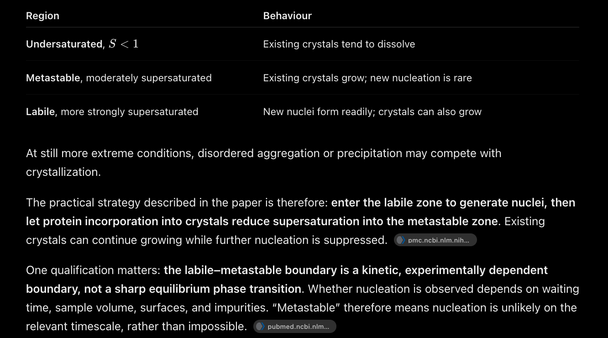

# Chemical Space Papers

## Snell: The application and use of chemical space mapping to interpret crystallization screening results

See [here](https://pmc.ncbi.nlm.nih.gov/articles/PMC2631111).

Macromolecular crystallization screening is an empirical process which involves setting up experiments with a number of different cocktails designed to sample chemical space known to promote crystallization. In other words, the chemical cocktails are designed to supersaturate the macromolecule.

At the HWI, the HTS laboratory steps up crystallization experiments in 1536-well experiment plates. Each plate contains a single common macromolecule solution arrayed with an equal volume of 1536 different crystallization cocktails. An automated imaging system records the experiments' outcomes 1d after the addition of the protein solution and weekly thereafter for four weeks.

These are analyzed manually with an in-house software package. There are 7 possible image categories:

1. crystal
2. precipitate
3. clear
4. phase separation
5. skin
6. unknown
7. garbage

Crystallization begins when the biochemical conditions promoting supersaturation of the macromolecule produce ordered aggregates. These ordered aggregates (e.g, nuclei) form in the labile zone; a higher level of supersaturation than required for crystal growth.

As the solution conditions change, the protein is sequestered in the nuclei; this can decrease the level of supersaturation and shift the conditions to a metastable region that supports crystal growth but not additional nucleation.

Crystallization is affected by more variables than macromolecule and precipitant concentrations alone and the effect of any single variable is often non-linear.

A macromolecule supersaturated in the metastable region will exhibit experimental results virtually indistinguishable from one in the under-saturated region. Both experiments appear as clear drops until a nucleation event occurs, yet the metastable region experiment is ideal for seeding and crystal growth.

One can still determine the distance of a clear drop to the metastable zone by checking the surrounding experiments.

3 primary variables (because they control protein solubility and protein-protein interactions):
- pH: influences the protein surface charge (via the protonation of amino-acid side chains) and contact chemistry,
- precipitating agents: change protein-solvent interactions and produce volume-exclusion effects, which can favour protein association and lower equilibrium solubility,
- inorganic salts: modify electrostatic screening and introduce ion-specific interactions,

### 2. Experimental

The current cocktails can be divided into 3 groups:

- salts (chemical compound consisting of positively charged ions (cations) and negatively charged ions (anions), bound together via ionic bonds),
- PEGs (polyethylene glycol, water-soluble polymers with repeating ethylene oxide units. This is used as a precipitating agent to promote supersaturation),
- commercial screen group,

### 4. Discussion

Crystallization cocktails are chemically related in space and therefore the results can be mapped and interpreted in that space. 

Another important aspect of mapping the results into chemical space is the ready identification of conditions that have not been sampled and the results surrounding those conditions. 

For example, if precipitation and clear results were seen along a chemical vector that included a large unsampled area of space, this would be a strong indication that this region is a candidate for exploration.

### 5. Conclusions

Representing crystallization results in chemical space quickly identifies optimization pathways and meaningful gaps in the sample chemistry. It allows the rapid visualization and interpretation of a complex experimental space.

### Relevant concepts

#### Labile zone

The labile zone is the range of solution conditions where supersaturation is high enough for new crystal nuclei to form at an appreciable rate during the experiment. At lower supersaturation—the metastable zone—an existing crystal can grow, but new nuclei rarely form.

Starting a crystal requires more supersaturation than growing a crystal because the surface cost plays a larger role than the bulk term (see attached images). Note that the critical size is inversely proportional to the log of S, the supersaturation.

#### Precipitant

A generic crystallization reagent. This changes the solution environment such that the protein is less soluble. Lowering its equilibrium solubility increases supersaturation.

#### DVR/T

Drop Volume Ratio/Temperature optimization. After finding a promising crystallization cocktail, protein and cocktail stock solutions are reused while varying their mixing ratio and incubating the resulting drops at different temperatures. The aim is to improve crystal size and quality without reformulating the cocktail.

### Images

## Reymond: The chemical space project

GDB-17 contains 166.4 billion molecules of up to 17 atoms of C, N, O, S and halogens. Molecules allowed by valency rules but unstable or nonsynthesizable due to strained topologies were not considered.

POC applications of GDB for drug discovery were done by combining virtual screening with chemical synthesis and activity testing for neurotransmitter receptor and transporter ligands.

Lesson: Using GDBs in drug analog searches shows that millions of very close analogs of any molecule can be readily identified by nearest-neighbor searchs in MQN-space of the various GDBs.

### Introduction

Organic molecules are defined by the number, type, topological connectivity and stereochemistry of the atoms described in their structural formula. 

The "drug-like" chemical space has been estimated at $10^{60}$ for all molecules obeying Lipinski's rule-of-5 for oral bioavailability, and at $10^{20-24}$ for all molecules up to 30 atoms.

### Enumeration

Method: enumerate all possible molecules - to gain an unbiased insight into the entire chemical space - by taking only simple chemical stability and synthetic feasibility criteria into account.

Starting with mathematical graphs produced by GENG, one subselected graphs suitable for saturated hydrocarbons (accounting for ring strain and topology and excluding planar or pyramidal quarternary centers). 

These were then converted into skeletons by introducing unsaturations following valency, aromaticity and ring strain rules (for example, removing bridgehead double bonds and allenes). Molecules were then obtained by mutating carbon atoms to N, O, S and halogenes while taking functional group stability into account (for example, excluding water-reactive groups, all heteroatom-heteroatom bonds except within aromatic rings, oximes and hydrazones).

Most GDB moleculues are stereochemically rich, have intermediate polarity with a 3D-shape, the latter is rather rare in historical drugs but correlates well with clinical success of drug candidates. 

### A periodic system of molecules

To efficiently find analogs of molecules, these are assigned a fingerprint and placed at the corresponding coordinates of a multidimensional space where each dimension represents one of the descriptors. This MQN system uses 42 molecular quantum numbers counting relevant features for chemical structure and biological activity. 

### Questions

- What is the MQN-space?
- What is meant by hydrocarbon saturation/unsaturation?
- Why are planar/pyramidal quarternary centers, bridgehead double bonds and allenes, and heteroatom-heteroatom bonds unphysical?
- What is chemical space travel?
- Why does 3D drug shape correlate with clinical success?

### Relevant concepts

#### Functional group

A molecular substituent responsible for the characteristics during chemical reactions. The same functional group undergoes identical or similar chemical reactions regardless of the rest of the molecule's composition, which enables systematic prediction of chemical reactions, behavior of chemical compounds and design of chemical synthesis.

The atoms in a functional group are linked to each other and to the rest of the molecule by covalent bonds.

#### Simplified Molecular Input Line Entry System (SMILES)

Line notation for describing the structure of chemical species using short ASCII strings. This can be obtained by printing the symbol nodes encountered in a depth-first tree traversal of a chemical graph; hydrogen atoms and cycles are broken into a spanning tree.

- Atoms are represented by the standard abbreviation of chemical elements inside square brackets [Au], unless they are common (in the organic subset) and obey certain rules.
- Bonds are represented by one of the following `. - = # $ : / \`. Single bonds can be written as `-` but are usually omitted.
- Rings are written by breaking each ring and adding numerical ring closure labels to show connectivity between non-adjacent terms